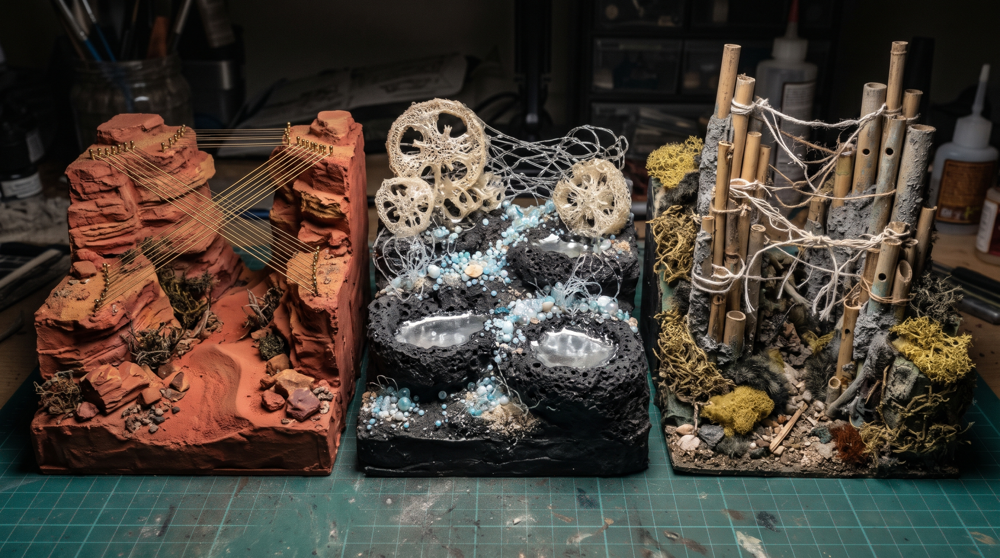
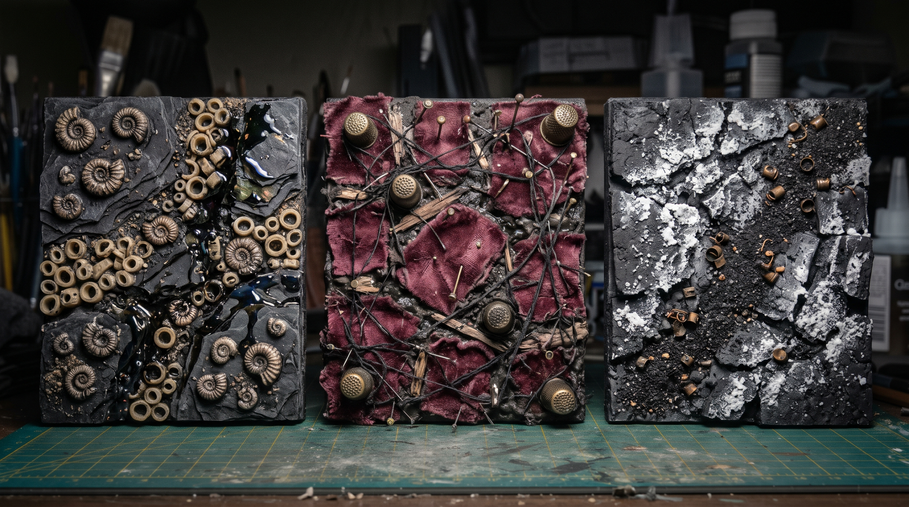
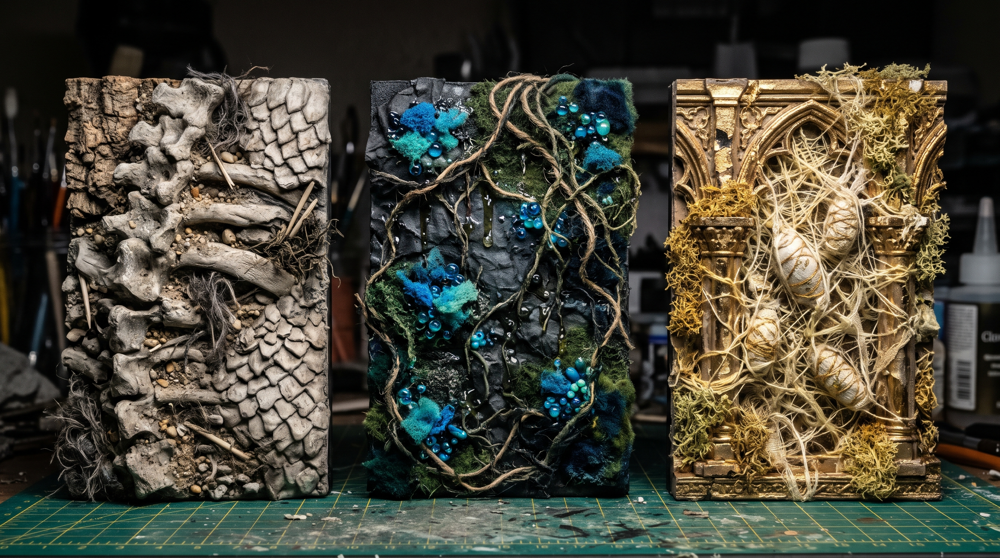

# Dark Craft style references

Dark Craft style references (Michael, Nov 17, 2026). Consistent design set; use as the material and colour bar for map slices. terrain_01 = 3 terrain blocks (red clay canyon with brass wire, black lava with glassy pools and loofah discs, bamboo with twine and moss). pathing_01 = 3 path panels (slate with ammonites and pasta rings, wine felt with thimbles and pins, cracked ash with copper bits). walls_01 = 3 wall panels (cork and bone vertebrae, black wrap with vines and teal beads, gilded gothic frame webbed with fibre and cocoons).

## Terrain

## Pathing

## Walls

