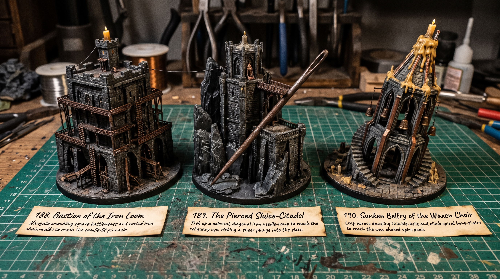
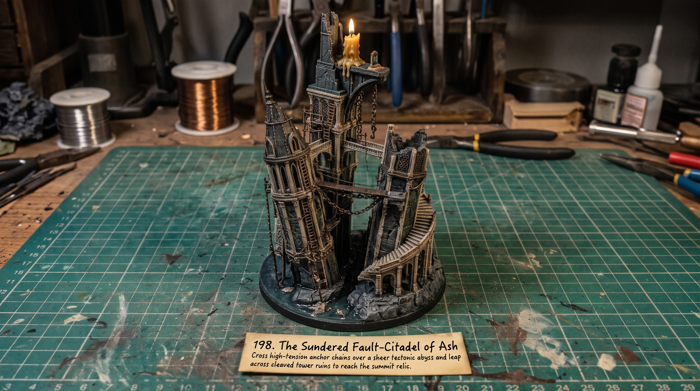
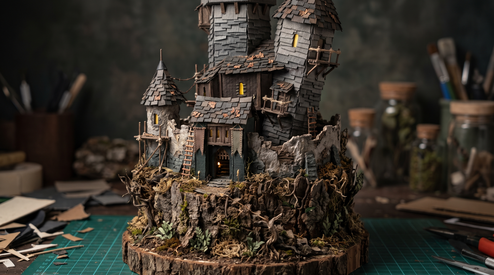
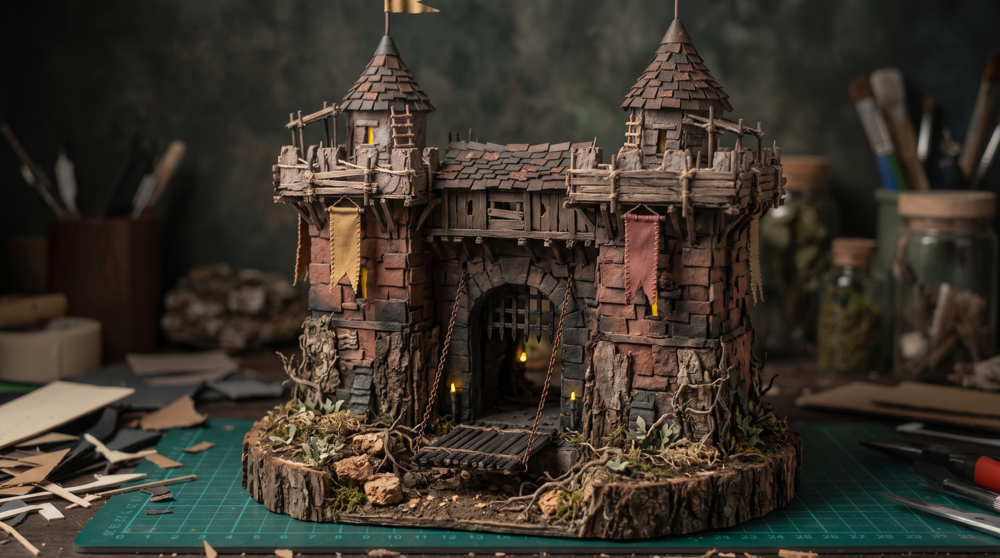
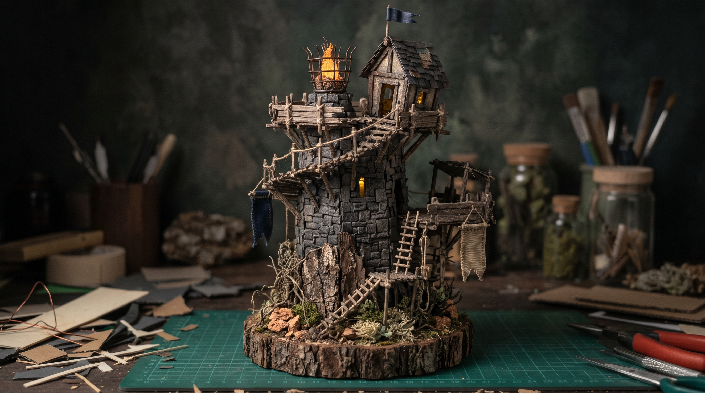
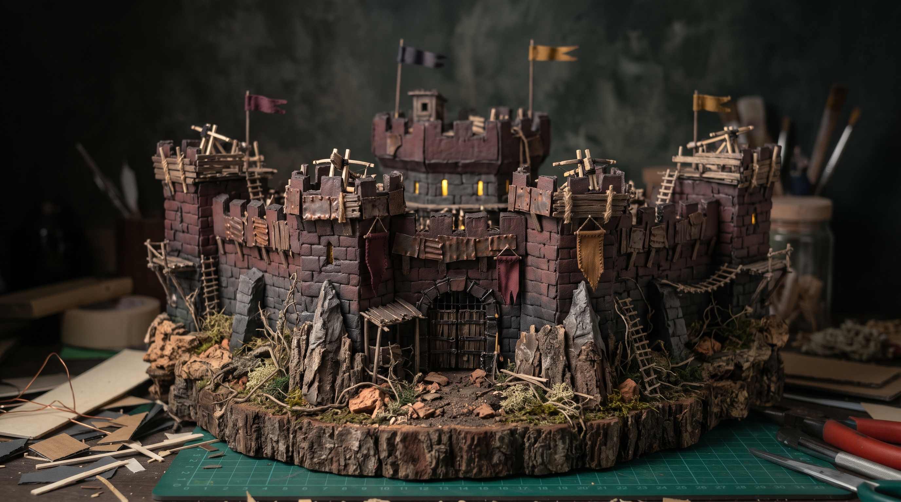

# Dark Craft architecture — fortified

Castles, keeps, walls of force, gate-like fronts, and towers. Nov 18 batch, unrated.

## fortified_01

Two ruined keep and tower maquettes with timber scaffolding and hanging cages.

Source (left in Downloads, not moved): `Gemini_Generated_Image_n8vnuen8vnuen8vn.jpg`

## fortified_02

A tall isolated ruined gothic tower or keep on a plaque.

Source (left in Downloads, not moved): `Gemini_Generated_Image_v9tknv9tknv9tknv.jpg`

## fortified_03

A sprawling dark gothic fortress with many towers and stacked walls.

Source (left in Downloads, not moved): `upsampled_img_12601362632881841492.jpg`

## fortified_04

A compact square castle keep with corner towers and a gated front.

Source (left in Downloads, not moved): `upsampled_img_5141899151475445231.jpg`

## fortified_05

A tall spiral-stair tower keep wrapped in wooden scaffolding.

Source (left in Downloads, not moved): `upsampled_img_15916557552785235852.jpg`

## fortified_06

A circular crenellated castle with red banners and a tight inner court.

Source (left in Downloads, not moved): `upsampled_img_12071109905437670028.jpg`

