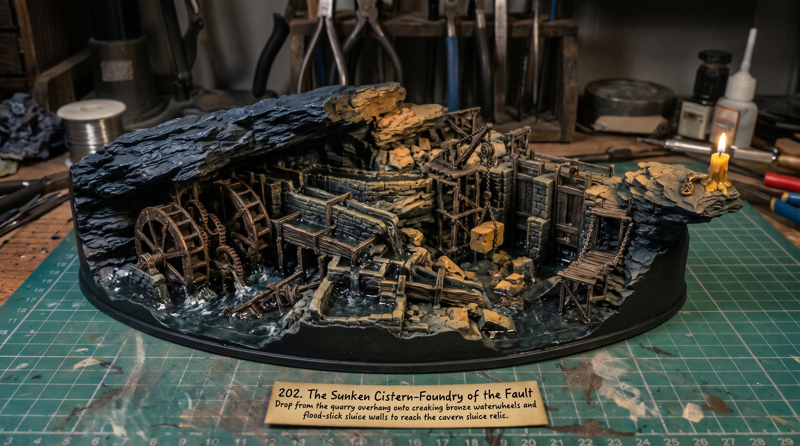
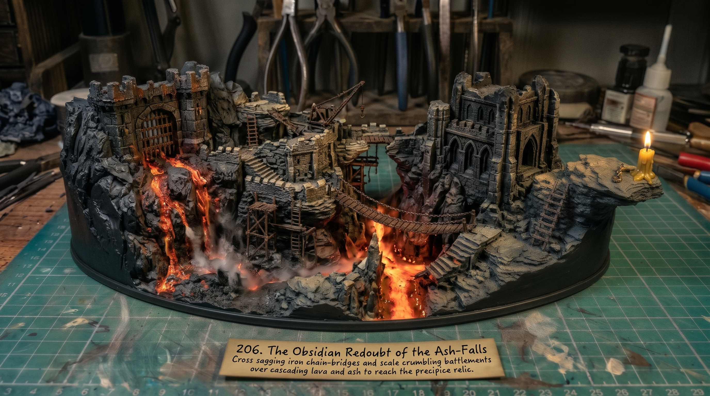
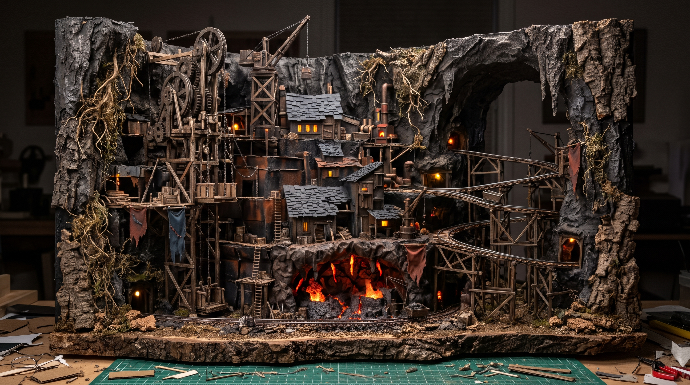

# Dark Craft architecture — industrial

Forges, foundries, and cutaway workshops. Nov 18 batch, unrated.

## industrial_01

A circular gear-and-pipe foundry pit with walkways around a central working floor.

Source (left in Downloads, not moved): `Gemini_Generated_Image_jdx31ujdx31ujdx3.jpg`

## industrial_02

A lava-channel forge fortress with a glowing molten cut through the middle.

Source (left in Downloads, not moved): `Gemini_Generated_Image_nbug7cnbug7cnbug.jpg`

## industrial_03

A cutaway mine and forge interior with scaffolding, tracks, and fire at the core.

Source (left in Downloads, not moved): `upsampled_img_18176828638150730298.jpg`

