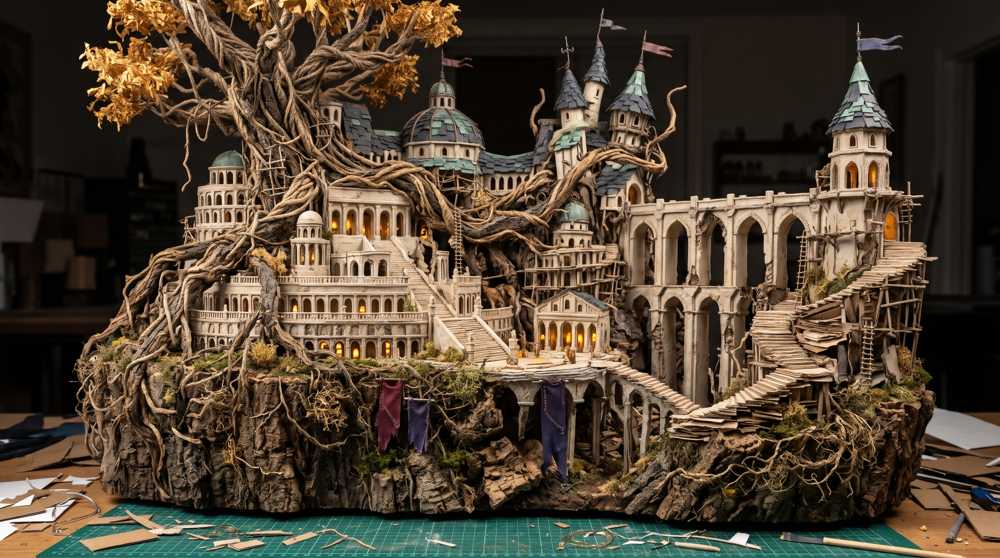
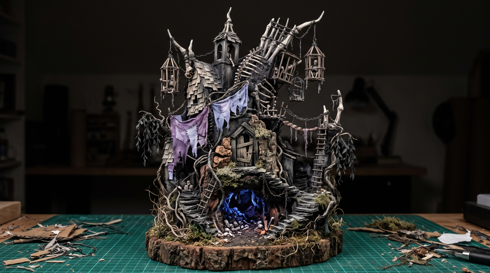
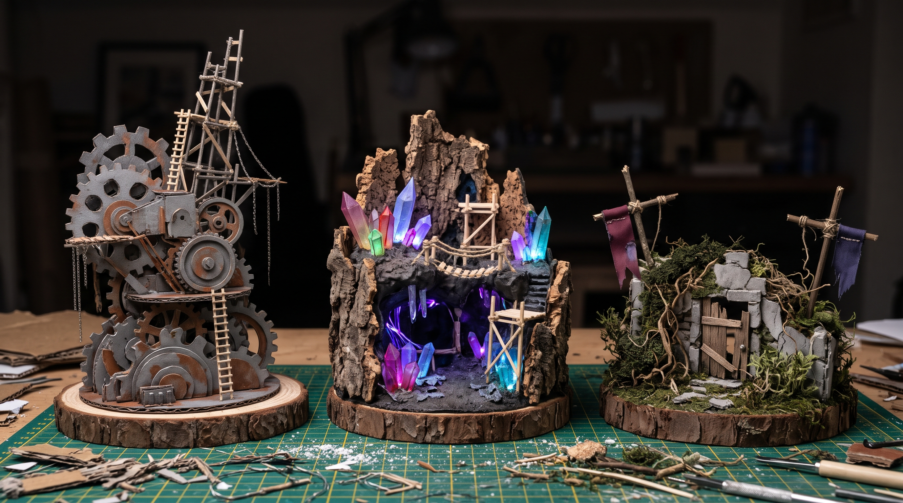

# Dark Craft architecture — otherworldly

Tree settlements, magic keeps, and clockwork or aether spires. Nov 18 batch, unrated.

## otherworldly_01

A colossal tree settlement with walkways and rooms grown into the trunk and branches.

Source (left in Downloads, not moved): `upsampled_img_8618338689607644647.jpg`

## otherworldly_02

A dark magic castle or keep with purple light and jagged spires.

Source (left in Downloads, not moved): `upsampled_img_2099550639170147919.jpg`

## otherworldly_03

Three clockwork and aether spire maquettes with gearwork and violet glow.

Source (left in Downloads, not moved): `upsampled_img_106062885559454241.jpg`

