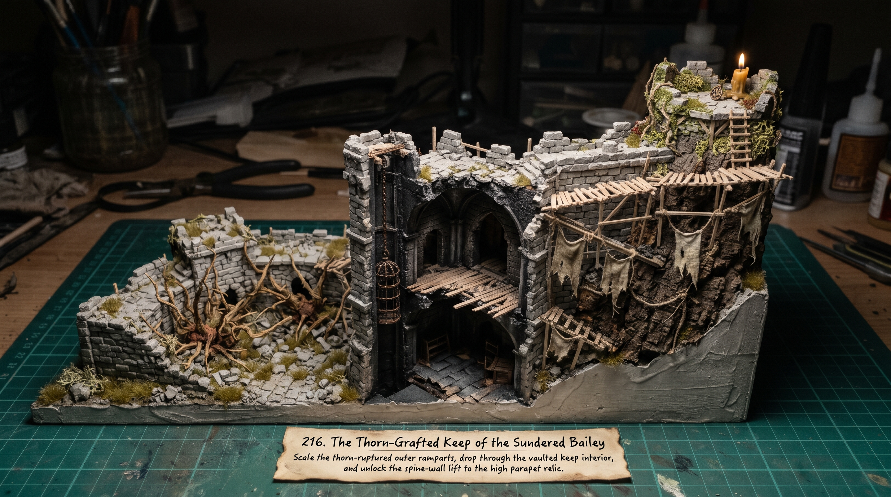
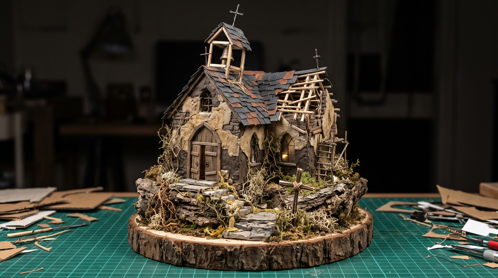
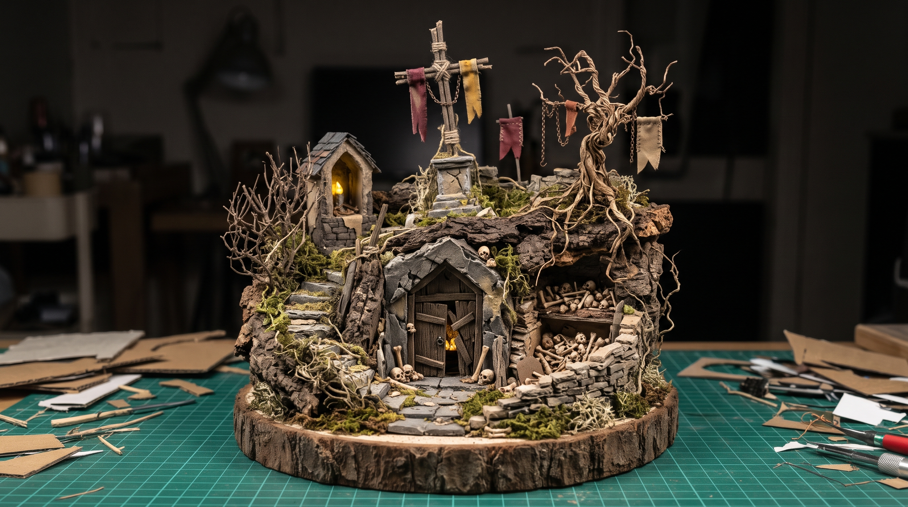
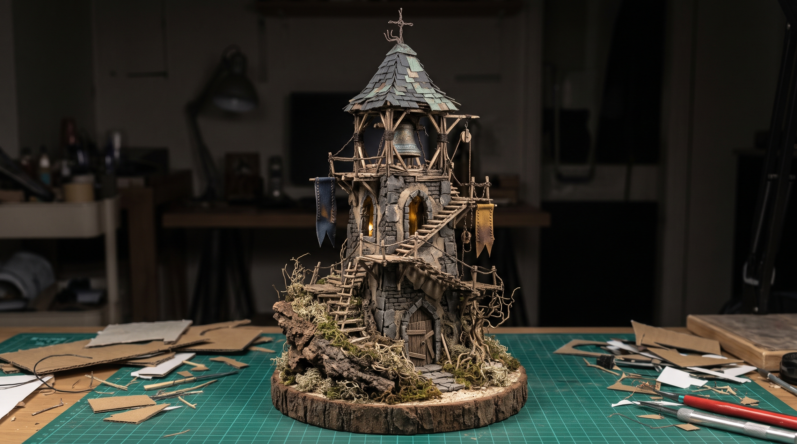
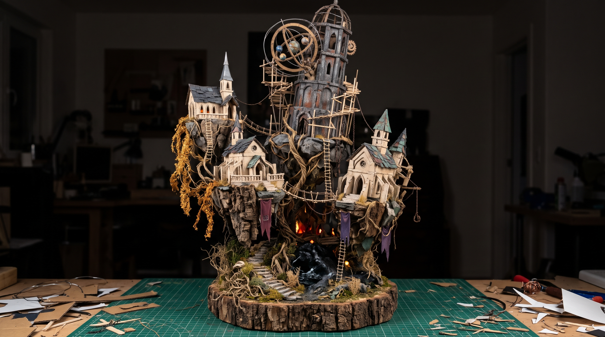

# Dark Craft architecture — religious

Cathedrals, churches, chapels, and graveyard shrines. Nov 18 batch, unrated.

## religious_01

A ruined gothic cathedral facade with a great arched window.

Source (left in Downloads, not moved): `Gemini_Generated_Image_jylay2jylay2jyla.jpg`

## religious_02

A rustic chapel set in a graveyard among trees.

Source (left in Downloads, not moved): `upsampled_img_5610040684492353252.jpg`

## religious_03

A dark woodland chapel or shrine standing among graves.

Source (left in Downloads, not moved): `upsampled_img_722068668205319135.jpg`

## religious_04

A church with a tall tower and a small graveyard.

Source (left in Downloads, not moved): `upsampled_img_16282695208930779357.jpg`

## religious_05

A dark gothic cathedral-castle with a magical glow at the spire.

Source (left in Downloads, not moved): `upsampled_img_2691753696019653281.jpg`

