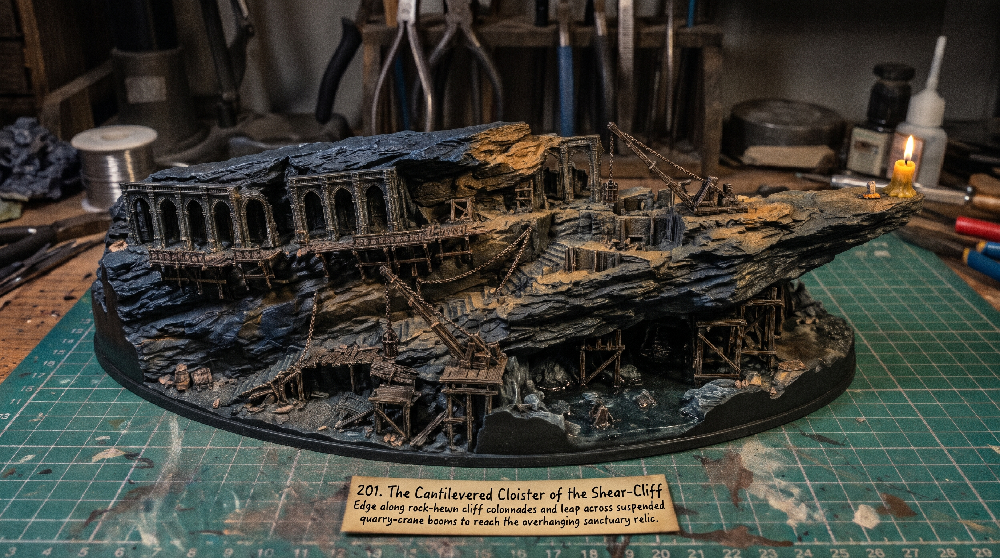

# Dark Craft architecture — ruins

Decay-first ruins whose original type is mixed or unclear. Nov 18 batch, unrated.

## ruins_01

A ruined classical colonnade and terrace on a slope, half-collapsed into the hillside.

Source (left in Downloads, not moved): `Gemini_Generated_Image_minjl4minjl4minj.jpg`

