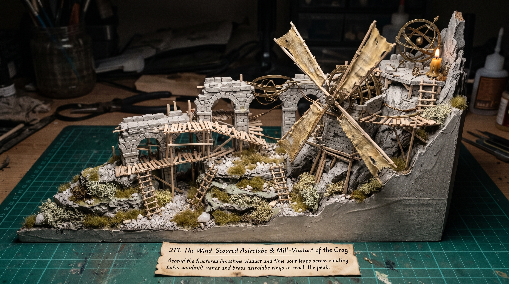
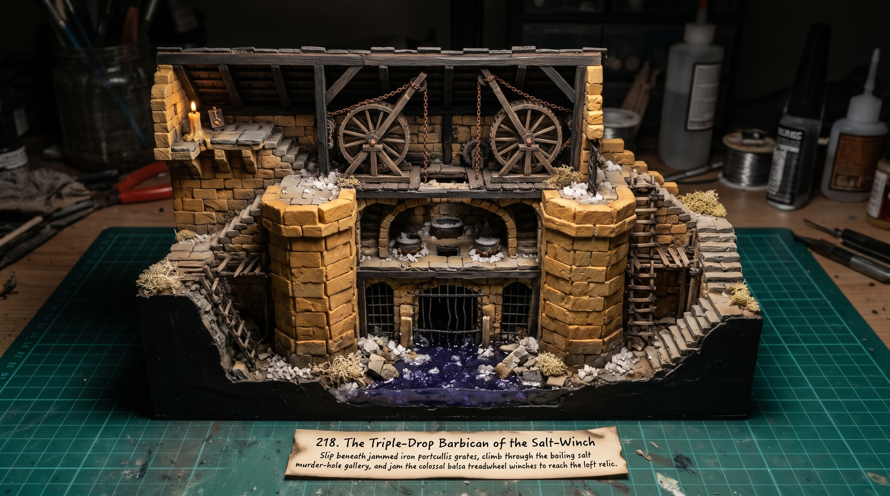
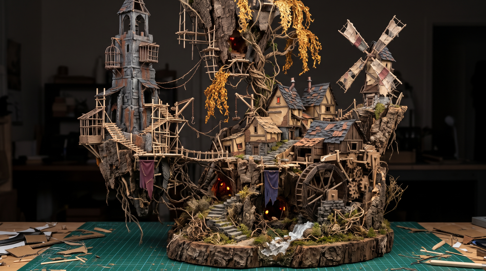
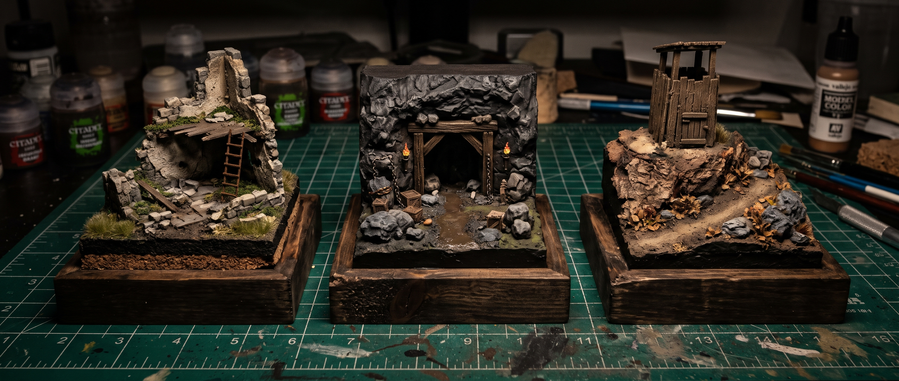

# Dark Craft architecture — rural

Villages, mills, cottages, and well courts. Nov 18 batch, unrated.

## rural_01

A hillside ruin with a windmill, broken walls, and terraced fields.

Source (left in Downloads, not moved): `Gemini_Generated_Image_2achd52achd52ach.jpg`

## rural_02

A well courtyard with twin yellow towers and a wooden water wheel.

Source (left in Downloads, not moved): `Gemini_Generated_Image_dot7f5dot7f5dot7.jpg`

## rural_03

A root-bound hill settlement built around a windmill.

Source (left in Downloads, not moved): `upsampled_img_6944648911239200936.jpg`

## rural_04

Three house and shrine cubes: a cave chapel, a dark hut, and a lit stone cottage.

Source (left in Downloads, not moved): `hf_20261118_225219_9dfd3c25-0f94-4dcb-8faa-94e05f3af4c8.png`

