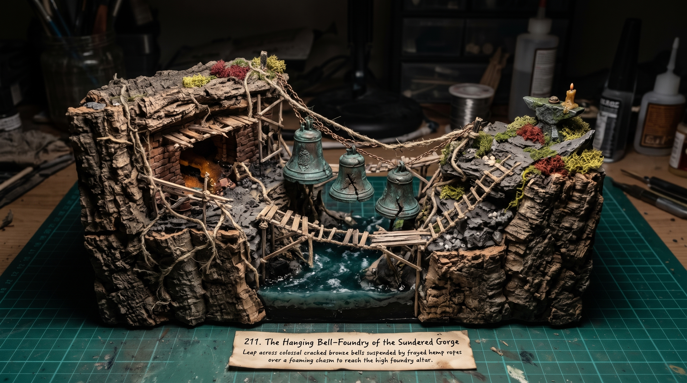
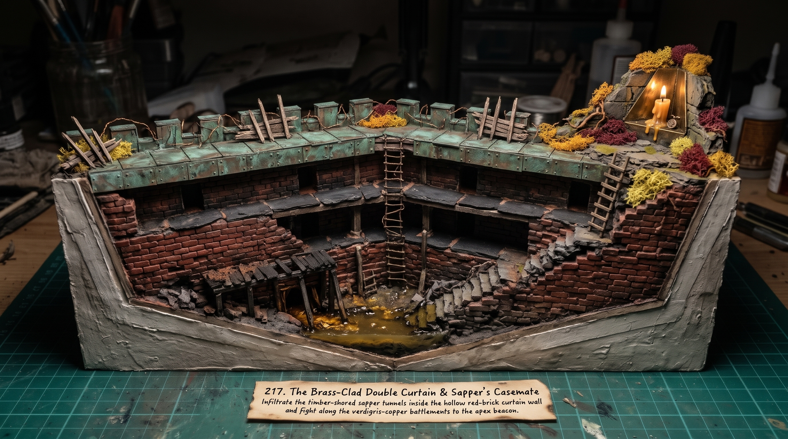

# Dark Craft architecture — underground

Caves, mines, and excavated pits. Nov 18 batch, unrated.

## underground_01

A cave chasm crossed by a rope and timber bridge, with water below.

Source (left in Downloads, not moved): `Gemini_Generated_Image_latd11latd11latd.jpg`

## underground_02

A deep timbered excavation pit with switchback walkways down the walls.

Source (left in Downloads, not moved): `Gemini_Generated_Image_29fj9d29fj9d29fj.jpg`

