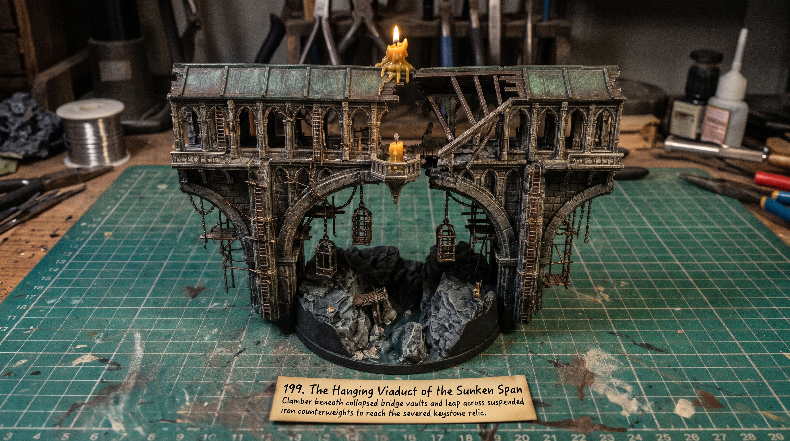
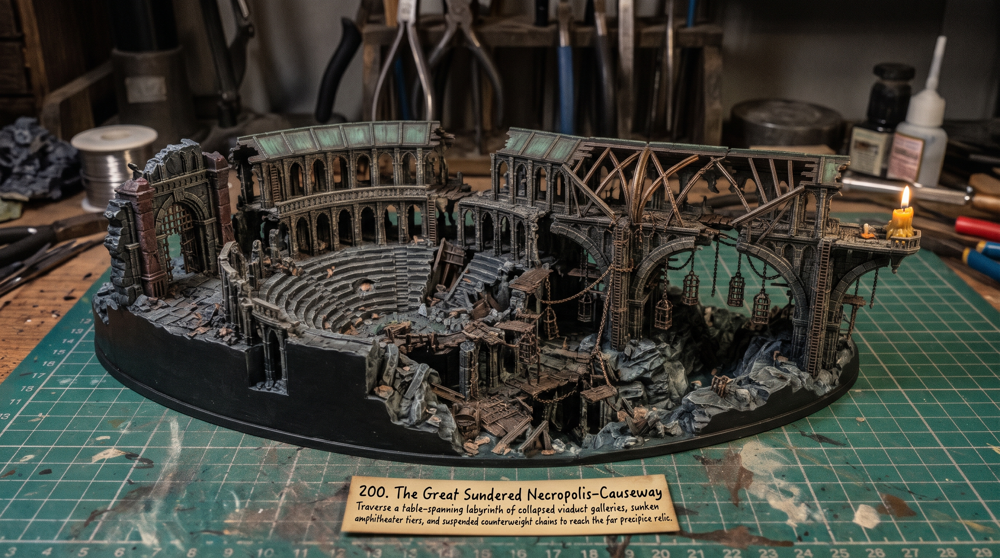
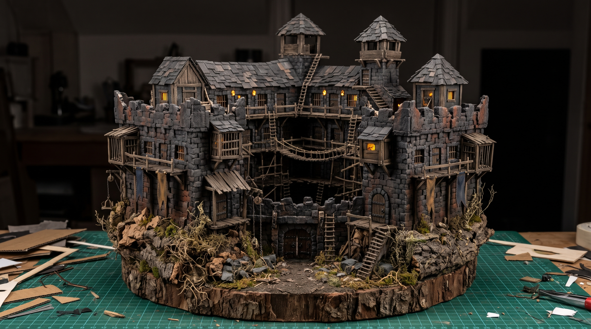

# Dark Craft architecture — urban

Bridges, aqueducts, and terraced towns. Nov 18 batch, unrated.

## urban_01

A ruined stone arch bridge spanning a gap, with hanging remnants beneath the deck.

Source (left in Downloads, not moved): `Gemini_Generated_Image_rwfu2yrwfu2yrwfu.jpg`

## urban_02

A ruined aqueduct or arcade running along a hillside above broken ground.

Source (left in Downloads, not moved): `Gemini_Generated_Image_167d77167d77167d.jpg`

## urban_03

A terraced cliff-side fortress town stacked in many inhabited levels.

Source (left in Downloads, not moved): `upsampled_img_13517114185535797696.jpg`

