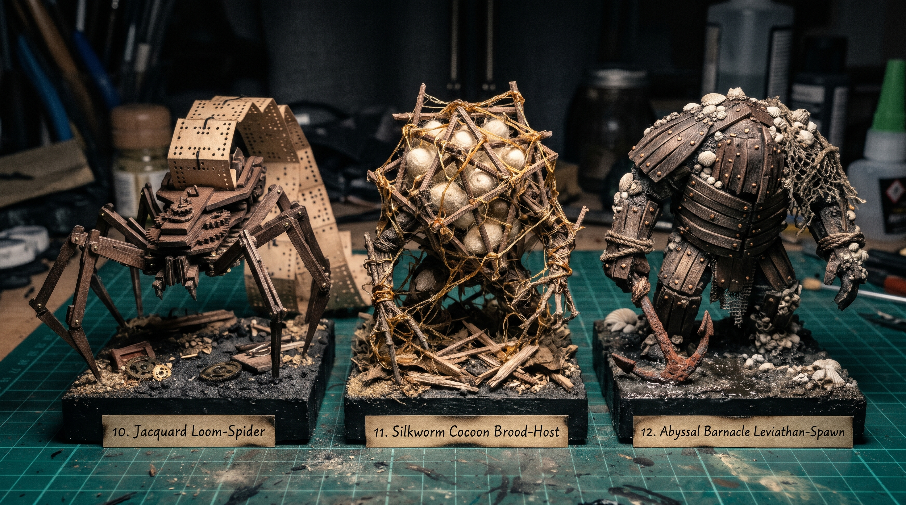
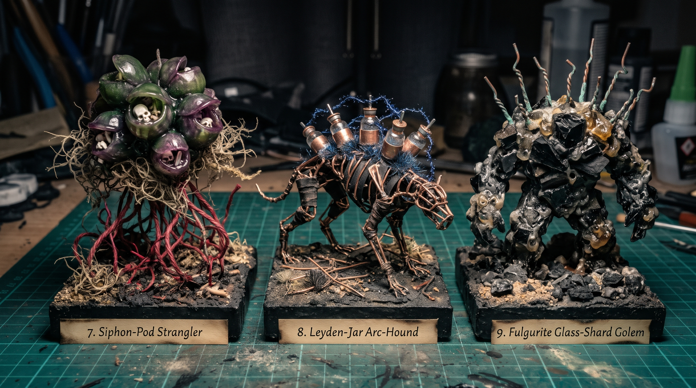
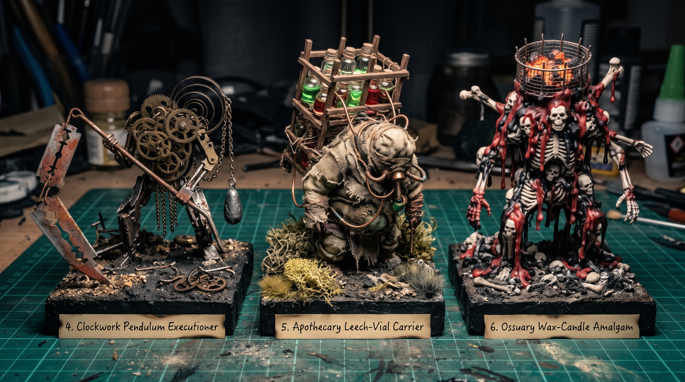
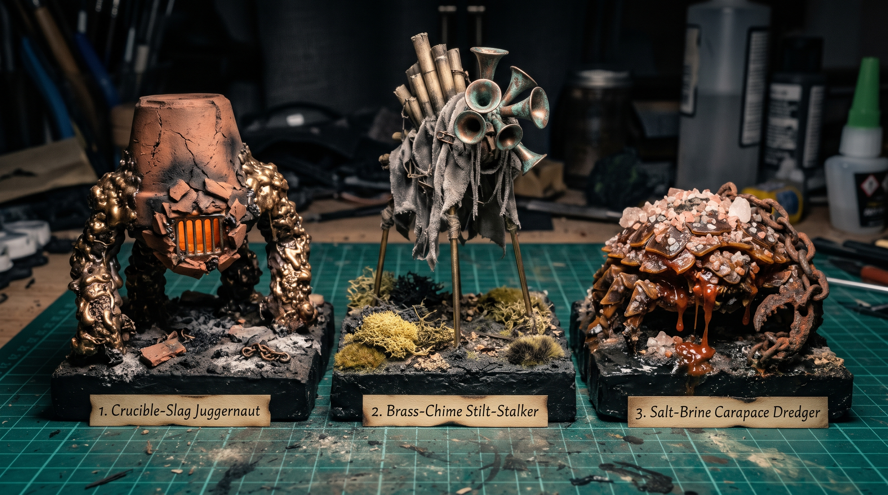
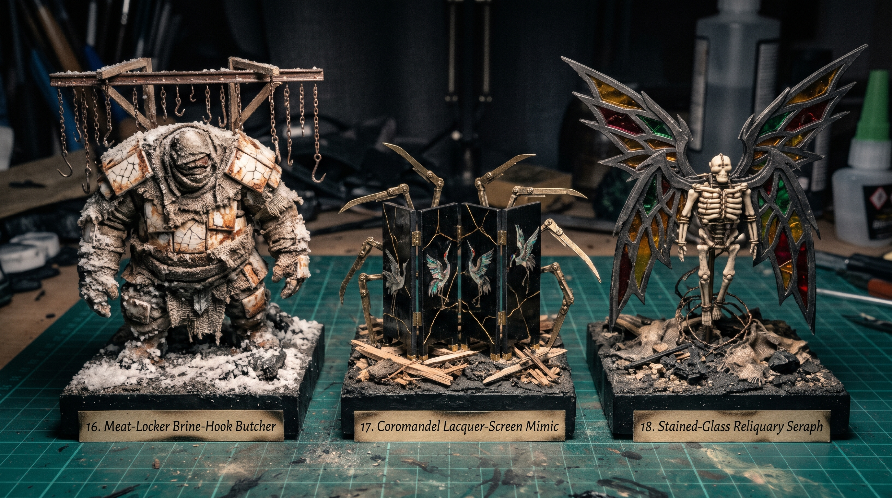
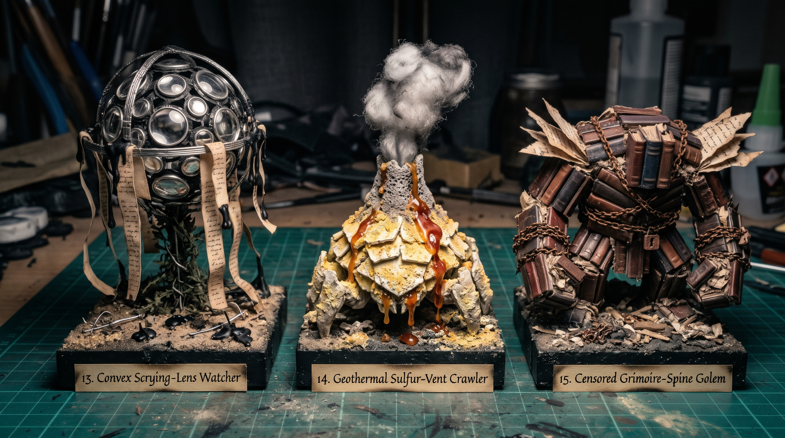
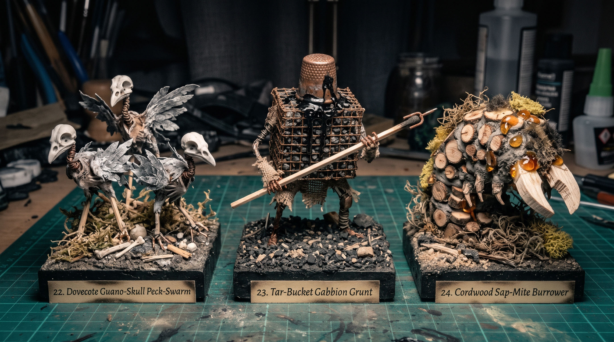
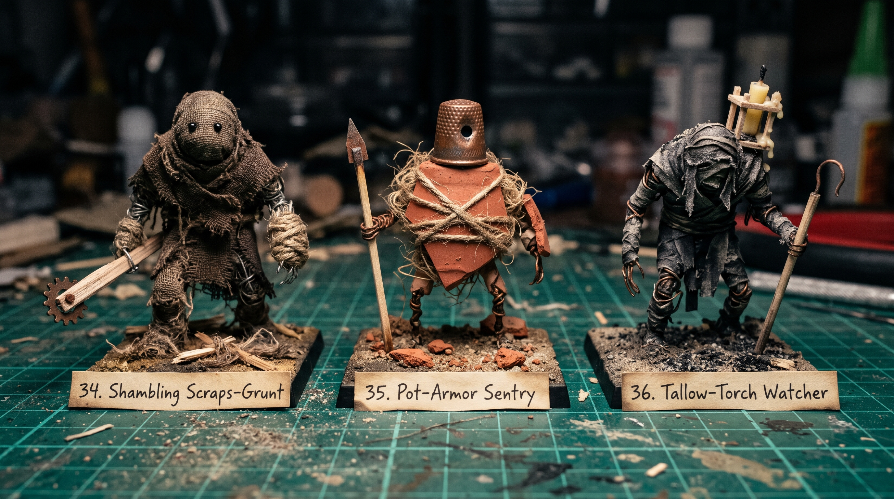

# Dark Craft enemies

Creature and enemy maquettes. Craft-material diorama pieces on a green cutting mat, photographed as a set of three.

## enemies_01

A jacquard loom-spider, a silkworm cocoon brood-host bound in a twig cage, and an abyssal barnacle leviathan-spawn.

## enemies_02

A syphon-pod strangler of hanging green pods, a leyden-jar arc-hound, and a fulgurite glass-shard golem.

## enemies_03

A clockwork pendulum executioner, an apothecary leech-vat carrier, and an ossuary wire-cradle amalgam.

## enemies_04

A crucible-slag juggernaut with a glowing furnace belly, a brass-chime stilt-stalker, and a salt-brine carapace dredger.

## enemies_05

A moat-lurker briar-hook bulk under a wooden yoke, a commanderie lantern-screen mantid, and a stained-glass reliquary seraph.

## enemies_06

A spherical iron lattice watcher hung with pale ribbons, a geothermal sulfur-vent crawler, and a cenotaph cremator-spiral golem.

## enemies_07

A flock of bone crows on a skull pile, a tar-racket cauldron giant with a long pole, and a cordwood sap-mite burrower with a pale tusk.

## enemies_08

The same three pieces as enemies_07: bone crows, a tar-racket cauldron giant, and a cordwood sap-mite burrower. This is a separate file (not a SHA-256 match), visually almost identical.

## enemies_09

A shambling scrap-grunt in a sack hood, a pot-armor sentry with a spear, and a tallow-torch watcher with a hook.
