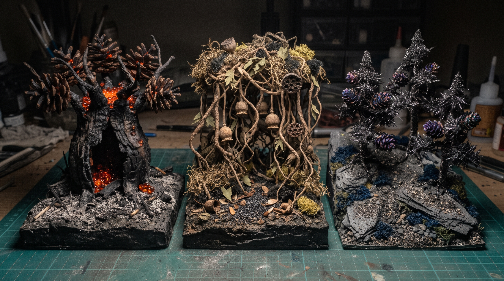
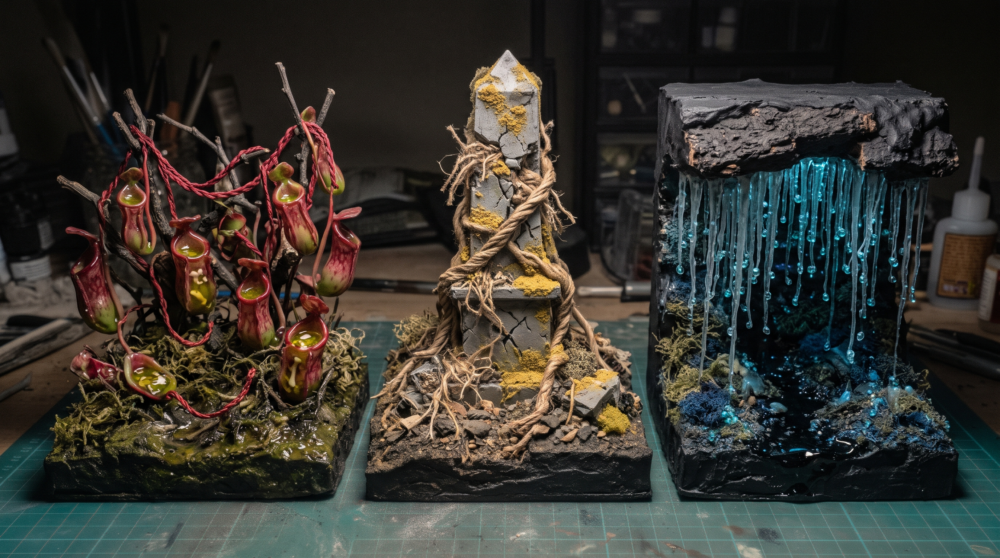
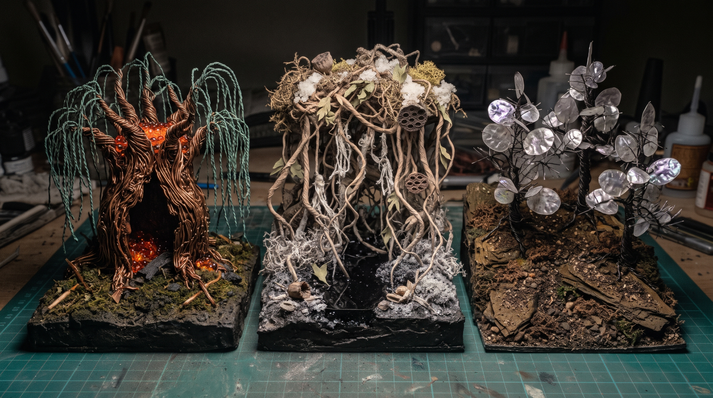

# Dark Craft foliage

Trees and plants. Craft-material diorama pieces on a green cutting mat, photographed as a set of three.

## foliage_01

Three foliage pieces: a charred hollow tree with pinecone crowns and glowing ember beads, a root-and-vine canopy hung with seed pods over moss, and black spiky pines with purple cones on slate.

## foliage_02

Red-flowered cacti, a twine-wrapped tree hung with seed pods, and a yellow shelf-fungus tree.

## foliage_03

Pitcher plants on a mossy base, a vine-wrapped stone obelisk, and a grotto with dripping blue icicles.

## foliage_04

A copper willow with a glowing ember core, a hanging-root canopy over a dark pool, and silver disc-leaf trees on slate.
