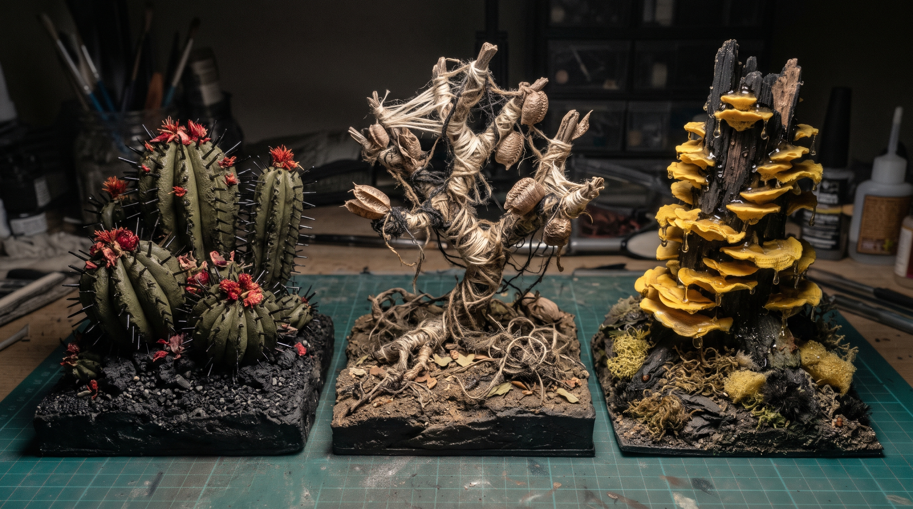
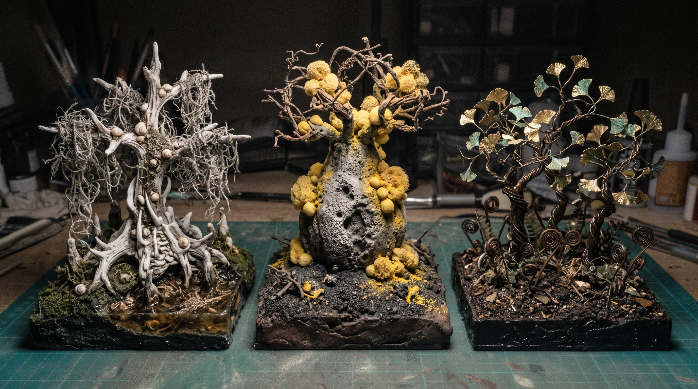
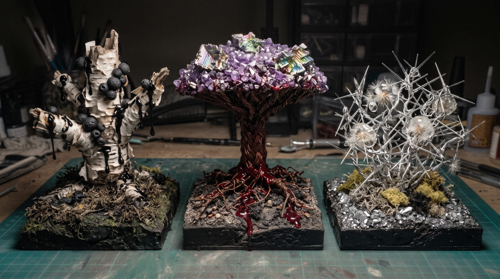
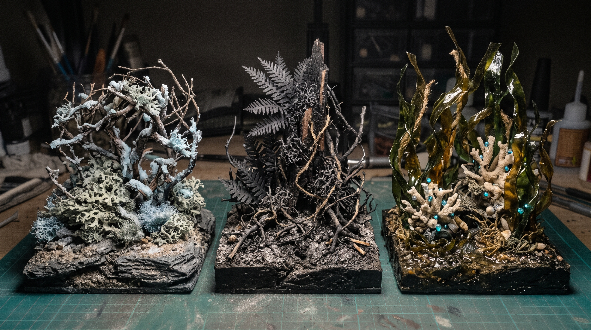
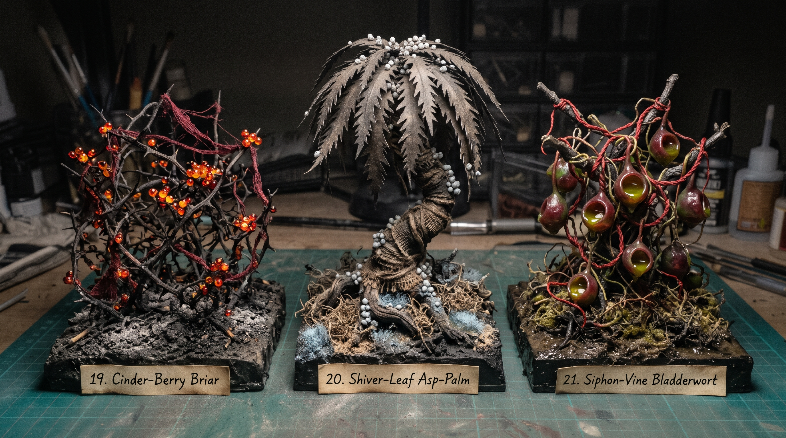
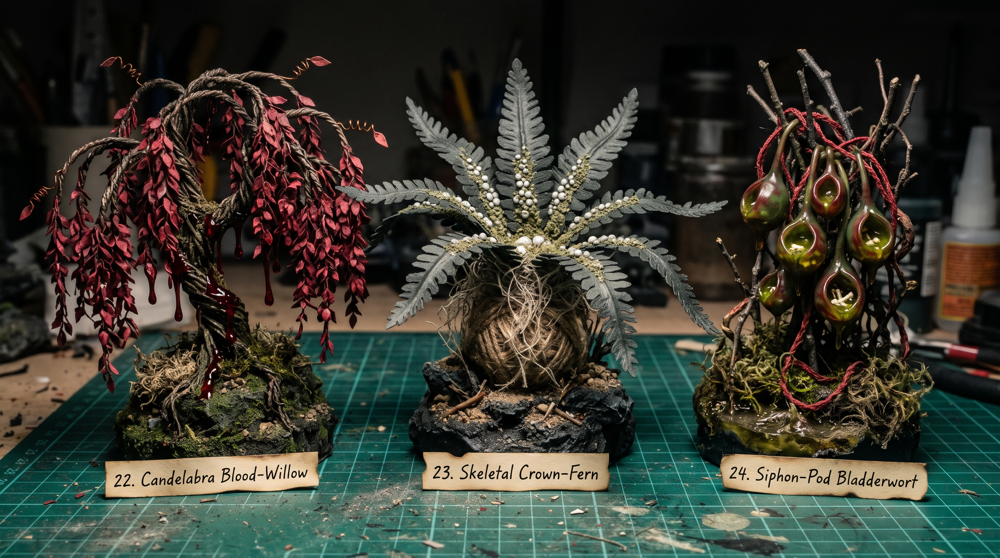
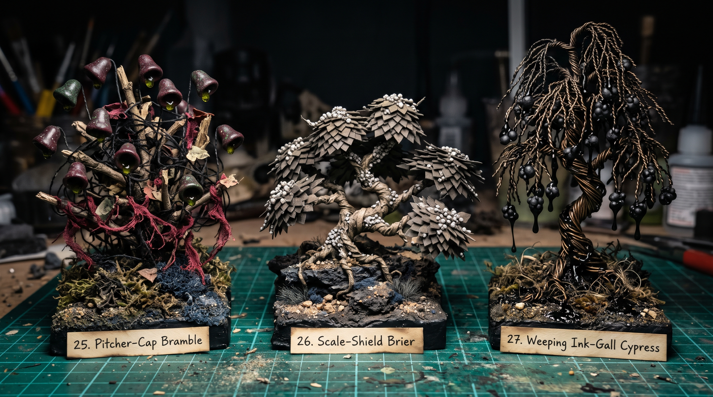

# Dark Craft foliage

Trees and plants. Craft-material diorama pieces on a green cutting mat, photographed as a set of three.

## foliage_01

Three foliage pieces: a charred hollow tree with pinecone crowns and glowing ember beads, a root-and-vine canopy hung with seed pods over moss, and black spiky pines with purple cones on slate.

## foliage_02

Red-flowered cacti, a twine-wrapped tree hung with seed pods, and a yellow shelf-fungus tree.

## foliage_03

Pitcher plants on a mossy base, a vine-wrapped stone obelisk, and a grotto with dripping blue icicles.

## foliage_04

A copper willow with a glowing ember core, a hanging-root canopy over a dark pool, and silver disc-leaf trees on slate.

## foliage_05

A pale hanging-root tree with pearls, a swollen trunk studded with yellow puffballs, and a metal ginkgo with coiled stems.

## foliage_06

A white birch with black drips and nodules, an amethyst-crown tree with blood-red roots, and a silver spike tree with dandelion puffs.

## foliage_07

A pale blue lichen thicket, black ferns in dry twigs, and kelp blades over pale coral with teal beads.

## foliage_08

A dark briar with glowing ember berries, a grey palmate palm with white beads, and hanging yellow-red bladder pods on red tendrils.

## foliage_09

A weeping blood-red willow, a grey crown-fern from a twine bulb, and hanging siphon pods on red thread.

## foliage_10

A dark pitcher-cap bramble with hanging bells, a scale-shield brier with white bead tips, and a weeping ink-gall cypress with black berries.
