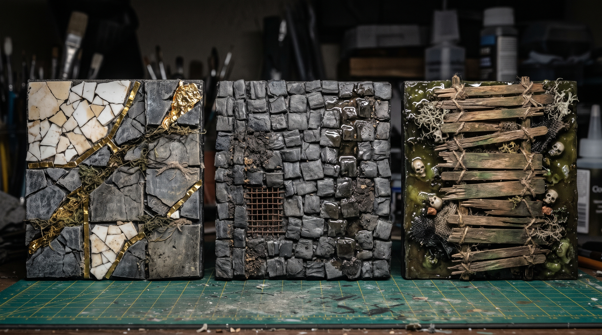

# Dark Craft paths

Flat floor or path panels. Craft-material diorama pieces on a green cutting mat, photographed as a set of three.

## paths_01

Three path panels: slate with ammonites and pasta rings, wine felt with thimbles and pins, and cracked ash with copper bits.

## paths_02

Gold-kintsugi cracked stone paving, wet cobblestones with a drain grate, and a wooden boardwalk over moss and skulls.

## paths_03

Broken paving over a buried skeleton, diamond-plate metal with blue tufts, and a skull-filled trench cut through stone paving.
