# Dark Craft paths

Flat floor or path panels. Craft-material diorama pieces on a green cutting mat, photographed as a set of three.

## paths_01

Three path panels: slate with ammonites and pasta rings, wine felt with thimbles and pins, and cracked ash with copper bits.

## paths_02

Gold-kintsugi cracked stone paving, wet cobblestones with a drain grate, and a wooden boardwalk over moss and skulls.

## paths_03

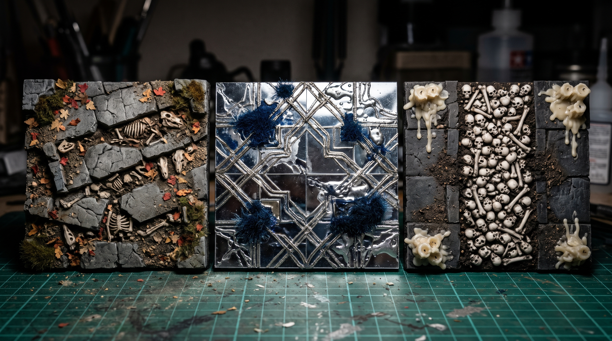

Broken paving over a buried skeleton, diamond-plate metal with blue tufts, and a skull-filled trench cut through stone paving.

## paths_04

A cracked salt-crust brine tile with a teal crystal star, an acoustic bronze-bell floor, and a tar-seep ribcage mine tile.

## paths_05

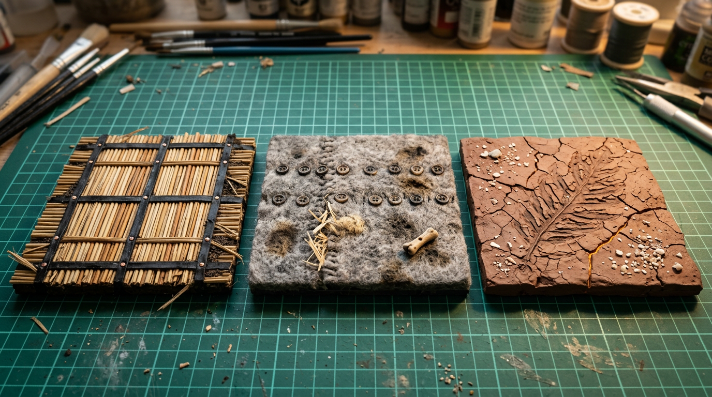

Three floor panels: a wooden plank grid, a cobble and gravel court, and a terracotta leaf-litter tile.

Source (copied, not moved): `hf_20261119_010318_bbca98ae-7a31-44bb-b710-2ccc4128f972.png`

## paths_06

Three ground panels: mixed moss and grit, dry sand with twigs, and a dark rocky debris floor.

Source (copied, not moved): `hf_20261119_010428_6f17563a-131a-4a68-a085-eef8aef70a5d.png`

## paths_07

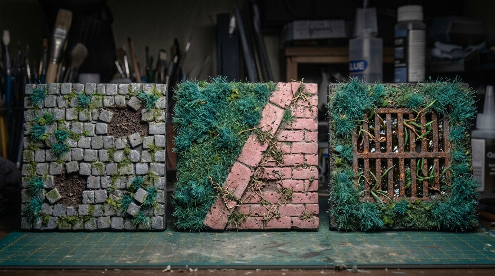

A mossy cobblestone path, a teal path with a pink brick strip, and a round grate set in moss.

Source (copied, not moved): `hf_20261119_010604_bf3af251-6091-4147-96db-8042b635d4aa.png`

## paths_08

Three paving panels: dark rock sockets, a pebble mosaic, and four circular stone basins.

Source (copied, not moved): `hf_20261119_010849_c46f4585-3414-47c0-97b4-f040b2b54c70.png`

## paths_09

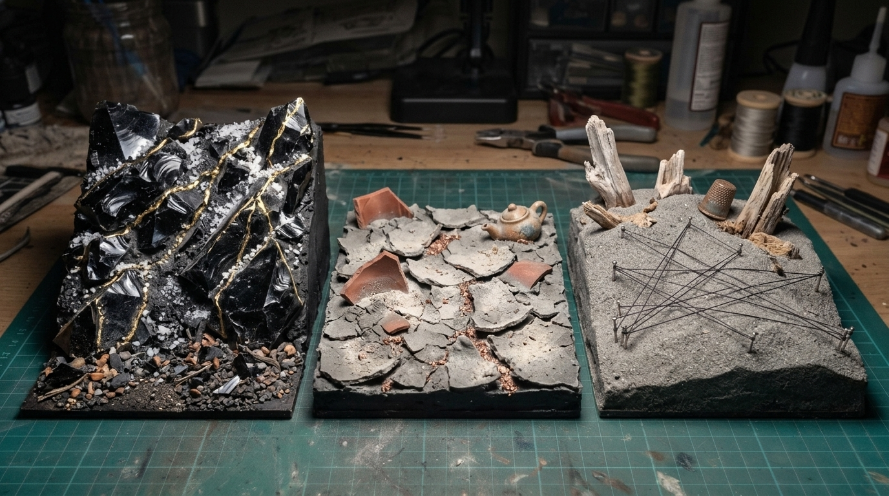

A dark cracked crystal wall, a crumbling brick ruin panel, and pale spiked stone.

Source (copied, not moved): `hf_20261119_010215_73385f64-b835-46d3-b401-e00b893fc1ed.png`

## paths_10

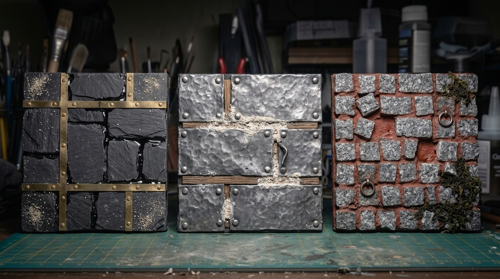

Three masonry panels: dark stone with gold grout, grey brick, and red herringbone brick.

Source (copied, not moved): `hf_20261119_010317_7f54bccb-87af-4e21-9653-2aaab3031377.png`

## paths_11

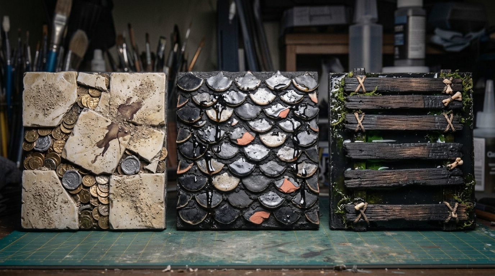

A cracked pale stone wall, a dark scale or slate shingle wall, and wet stepped stone.

Source (copied, not moved): `hf_20261119_010318_9054cab0-76f8-477e-95e2-f8d560a46fd1.png`

## paths_12

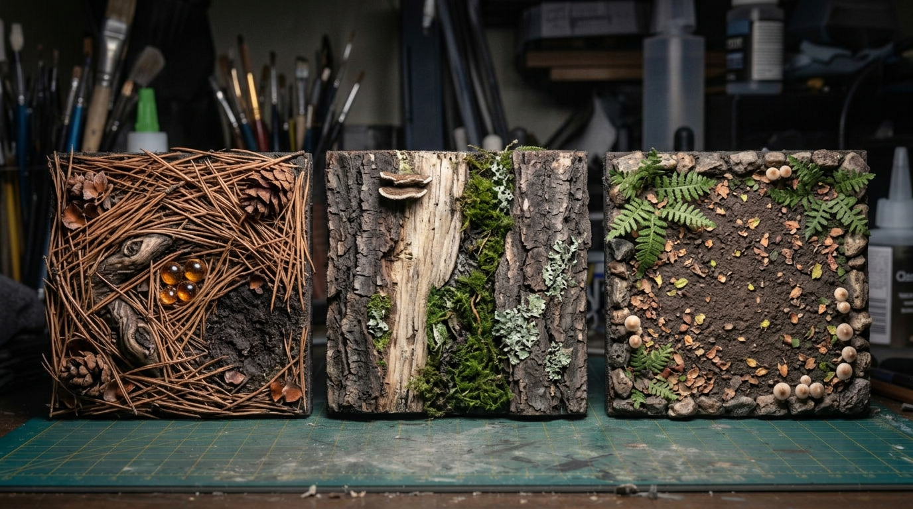

A thorny root-covered wall, a pale bark or wood grain panel, and a mossy forest-floor tile.

Source (copied, not moved): `hf_20261119_010429_caf1c52e-7108-4c96-aae3-2257998dd055.png`

## paths_13

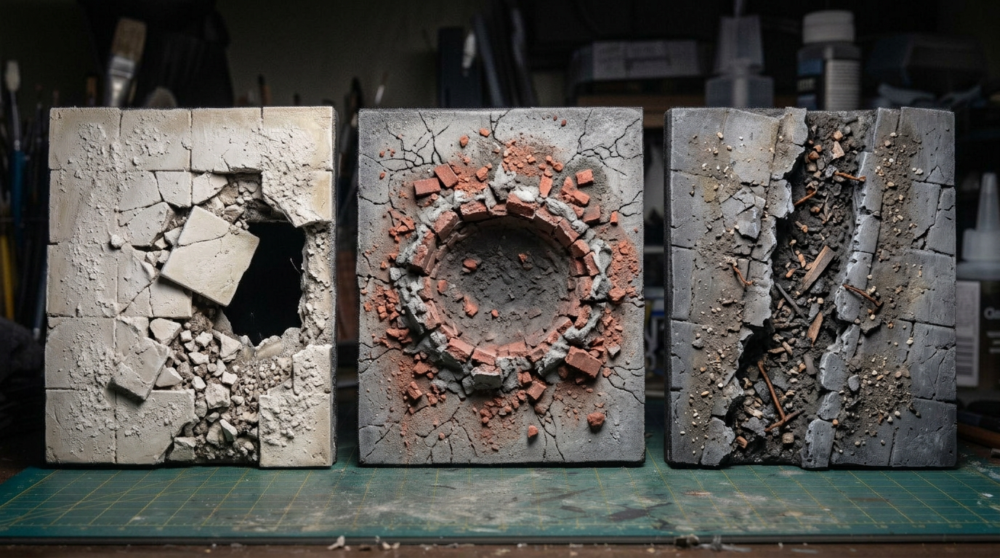

A blasted hole in plaster, a rusted circular breach, and a wall split by a deep crack.

Source (copied, not moved): `hf_20261119_010706_9a949f5e-b6d6-4a5b-8865-7fe670d7717f.png`

## paths_14

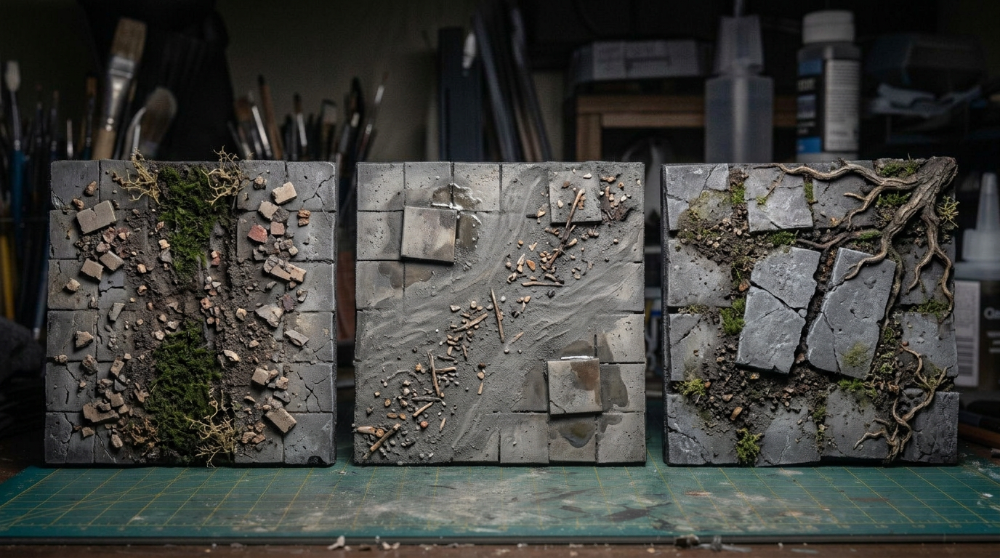

A mossy brick wall, a stone panel with a square niche, and a cracked wall bound by roots.

Source (copied, not moved): `hf_20261119_010707_6bb134e0-f93c-42d0-be02-0b423d09f08f.png`

## paths_15

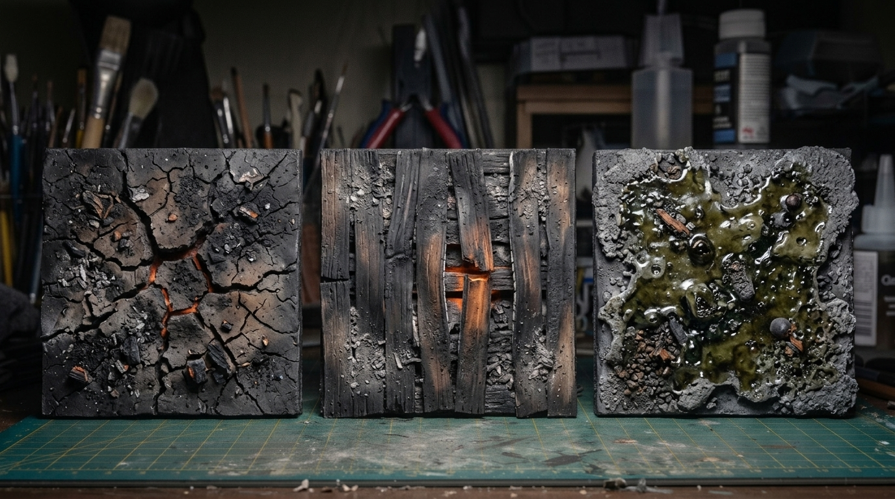

A cracked dark stone wall, charred timber with rusted pipes, and a rusted metal panel.

Source (copied, not moved): `hf_20261119_010707_7b8e3d71-e320-4399-ab24-5614df744dc3.png`

## paths_16

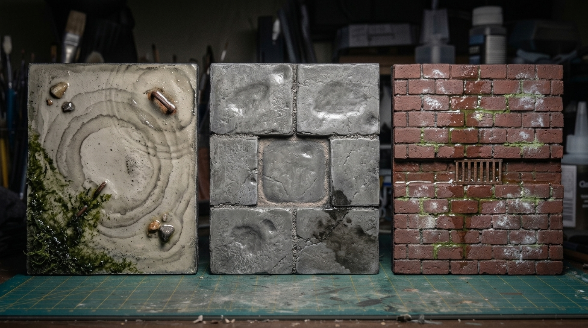

A circular drain in concrete, a stone block with square pipe outlets, and a red brick wall with a grate.

Source (copied, not moved): `hf_20261119_010744_c6f6864c-ac6c-422d-b81c-c2155f9699f5.png`

## paths_17

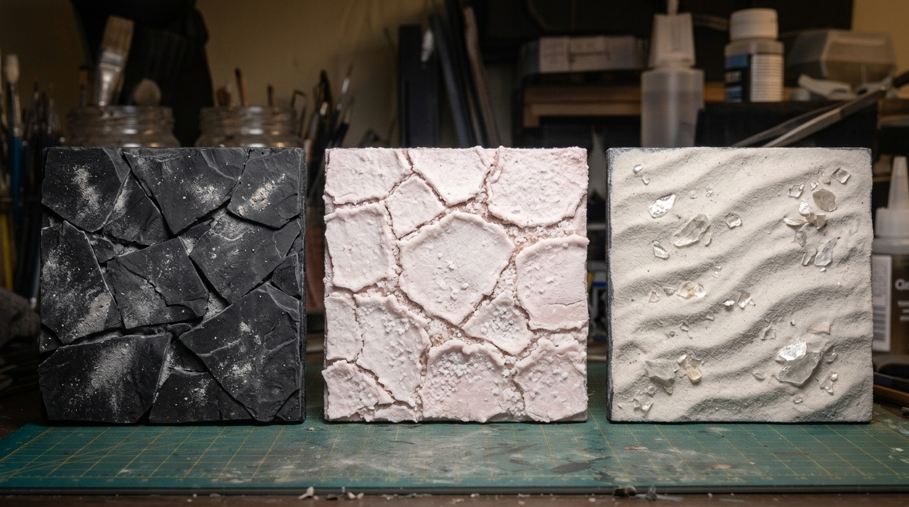

Three surface panels: dark cracked plaster, pink cracked plaster, and pale wavy relief.

Source (copied, not moved): `hf_20261119_010849_c992e8af-1ec1-4392-8660-d5c3c37d0cc8.png`

## paths_18

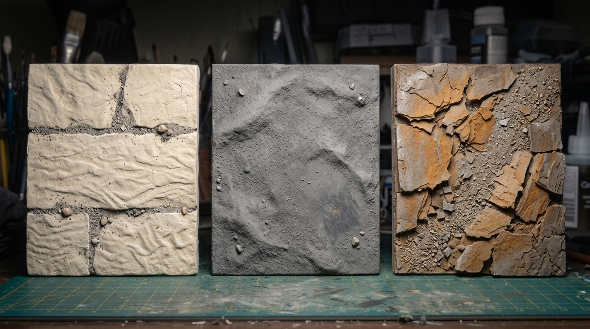

Pale stone blocks, a grey rough plaster wall, and peeling orange plaster over brick.

Source (copied, not moved): `hf_20261119_010849_ccbd4cb8-55e2-4831-9966-4d51a27635cc.png`

## paths_19

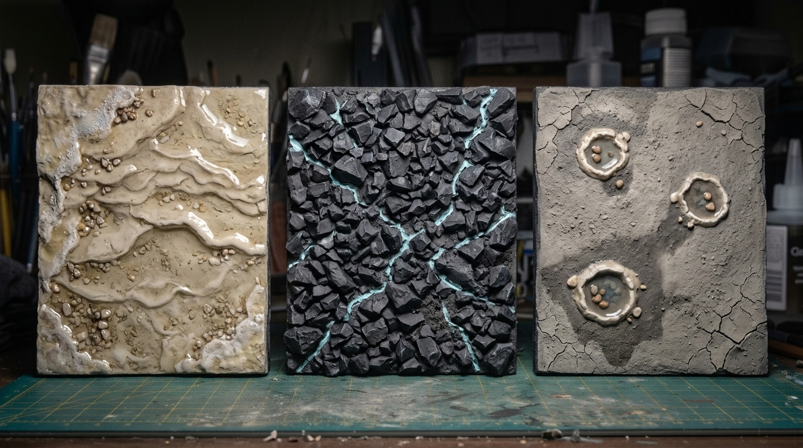

A pale wavy sand or plaster panel, dark cracked stone with teal veins, and grey stone with circular fossil pits.

Source (copied, not moved): `hf_20261119_010742_7b2cb1e4-fb0a-4994-a7ac-501c43ad2d4e.png`

