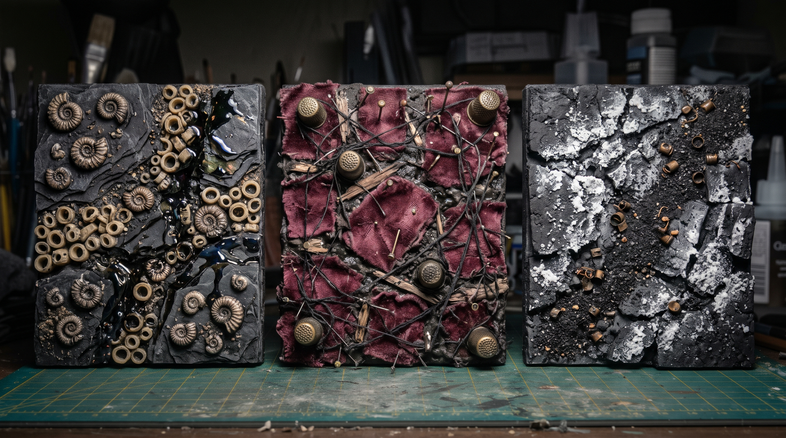
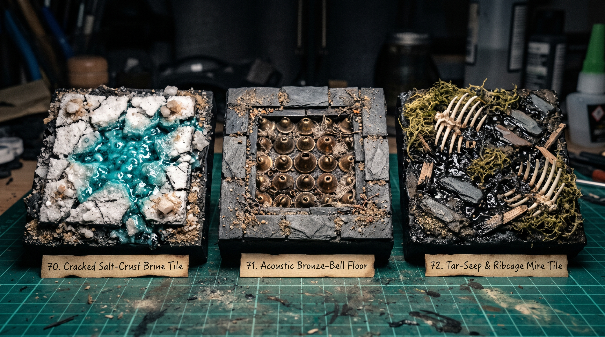
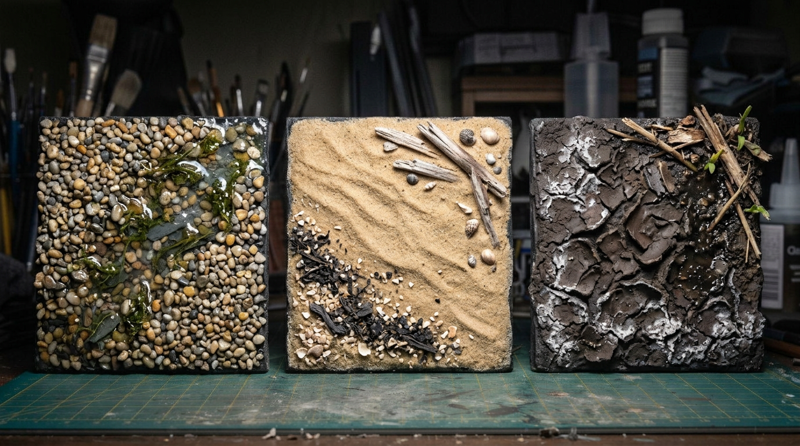
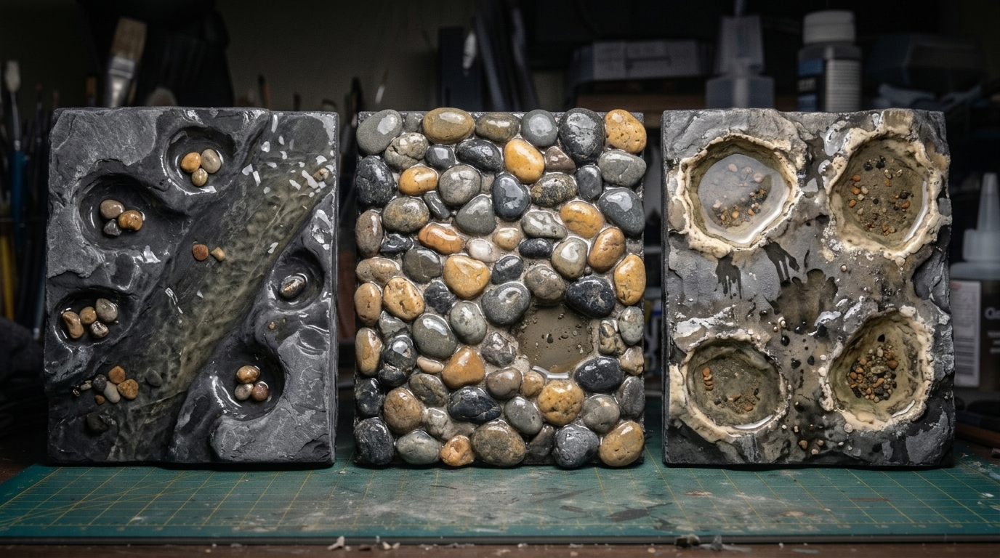

# Dark Craft paths

Flat floor or path panels. Craft-material diorama pieces on a green cutting mat, photographed as a set of three.

## paths_01

Three path panels: slate with ammonites and pasta rings, wine felt with thimbles and pins, and cracked ash with copper bits.

## paths_02

Gold-kintsugi cracked stone paving, wet cobblestones with a drain grate, and a wooden boardwalk over moss and skulls.

## paths_03

Broken paving over a buried skeleton, diamond-plate metal with blue tufts, and a skull-filled trench cut through stone paving.

## paths_04

A cracked salt-crust brine tile with a teal crystal star, an acoustic bronze-bell floor, and a tar-seep ribcage mine tile.

## paths_05

Three floor panels: a wooden plank grid, a cobble and gravel court, and a terracotta leaf-litter tile.

Source (copied, not moved): `hf_20261119_010318_bbca98ae-7a31-44bb-b710-2ccc4128f972.png`

## paths_06

Three ground panels: mixed moss and grit, dry sand with twigs, and a dark rocky debris floor.

Source (copied, not moved): `hf_20261119_010428_6f17563a-131a-4a68-a085-eef8aef70a5d.png`

## paths_07

A mossy cobblestone path, a teal path with a pink brick strip, and a round grate set in moss.

Source (copied, not moved): `hf_20261119_010604_bf3af251-6091-4147-96db-8042b635d4aa.png`

## paths_08

Three paving panels: dark rock sockets, a pebble mosaic, and four circular stone basins.

Source (copied, not moved): `hf_20261119_010849_c46f4585-3414-47c0-97b4-f040b2b54c70.png`

