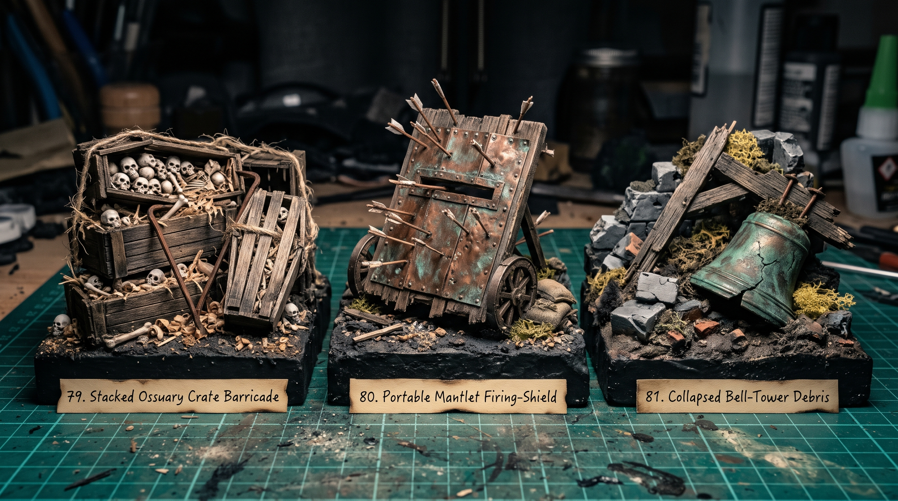
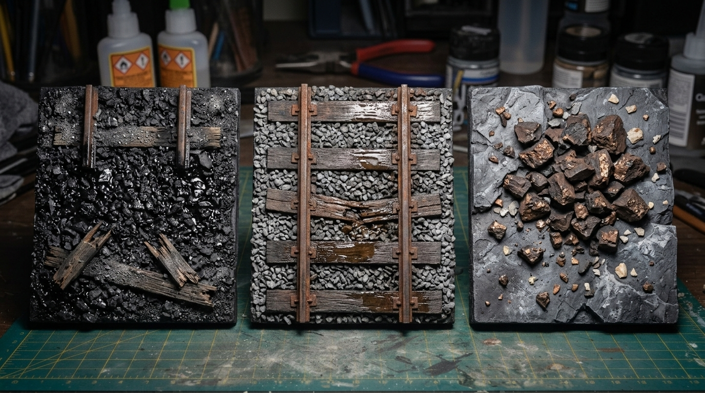

# Dark Craft props

Free-standing barricades, shields and debris. Craft-material diorama pieces on a green cutting mat, photographed as a set of three.

## props_01

A stacked ossuary crate barricade, a portable rusted mantlet firing-shield, and collapsed bell-tower debris with a fallen green bell.

## props_02

A debris tile with a fallen stick, a rusty ladder, and a rubble pile.

Source (copied, not moved): `hf_20261119_010743_23c43741-1312-4add-a430-a4d3edb47d5a.png`

