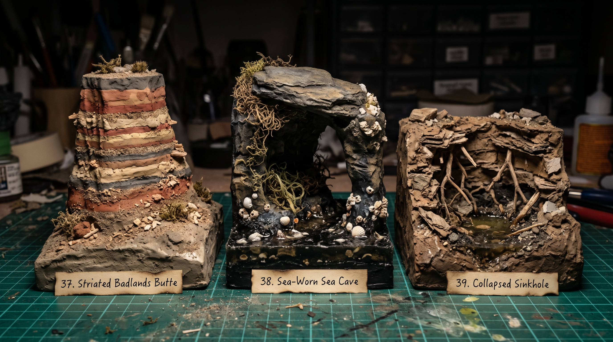
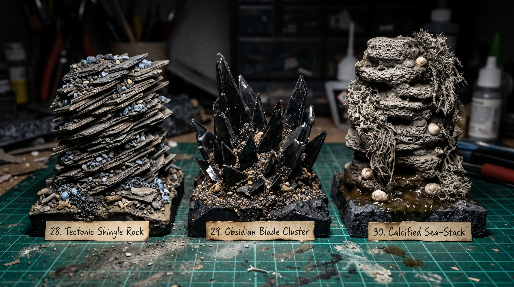
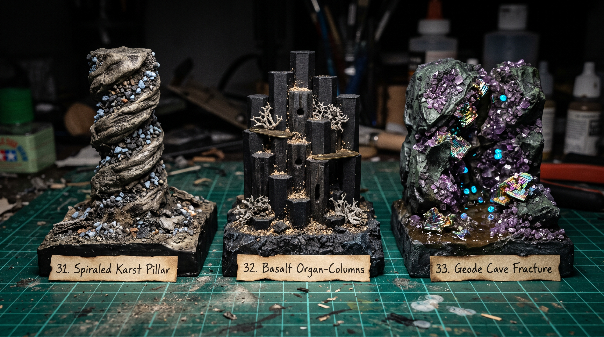
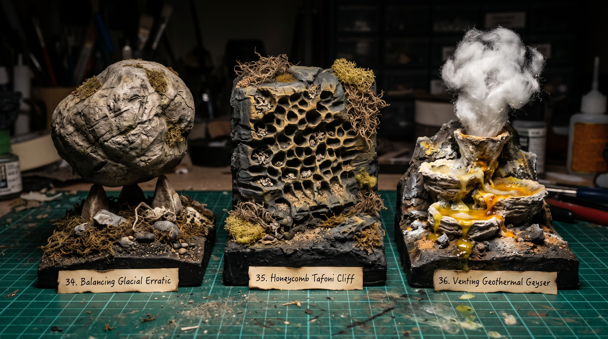
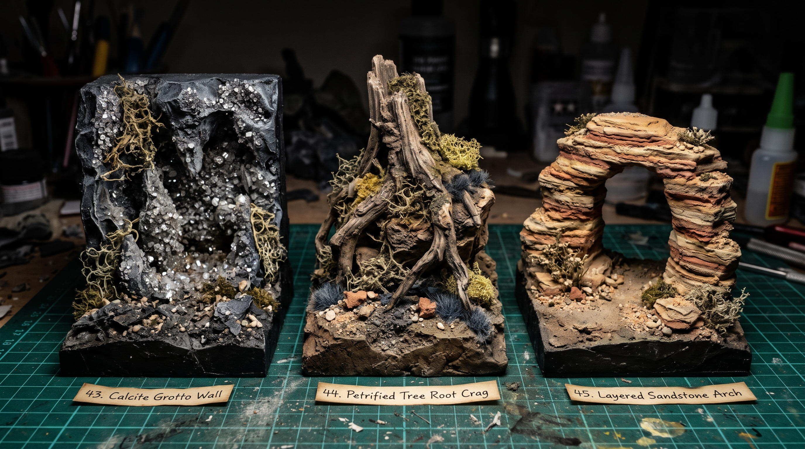

# Dark Craft rock formations

Natural rock landforms. Craft-material diorama pieces on a green cutting mat, photographed as a set of three.

## rock_formations_01

A striated badlands butte in layered red and tan bands, a sea-worn cave mouth with shells and weed, and a collapsed sinkhole of torn earth, roots and a murky pool.

## rock_formations_02

Stacked tectonic shingle rock with blue beads, a black obsidian blade cluster, and a calcified sea-stack with lichen and shells.

## rock_formations_03

A spiraled karst pillar bound in roots, black basalt organ-columns with pale lichen, and a geode cave fracture packed with purple crystals.

## rock_formations_04

A balancing glacial erratic on stone props, a honeycomb tafoni cliff with moss, and a venting geothermal geyser with amber flow and steam.

## rock_formations_05

A calcite grotto inlet packed with white crystals, a petrified tree-root cove with a dark hollow, and a layered sandstone arch.
