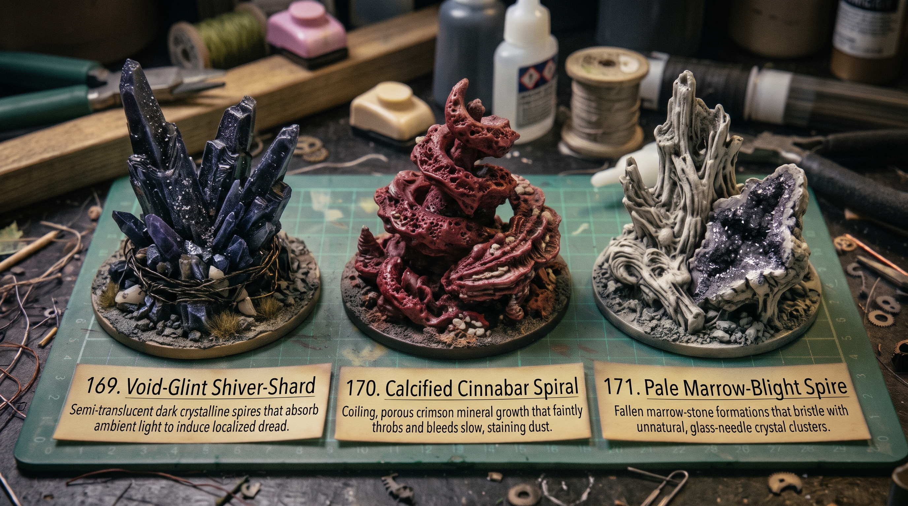
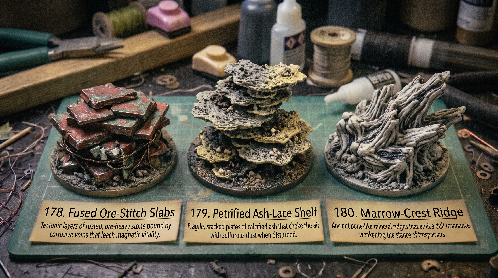
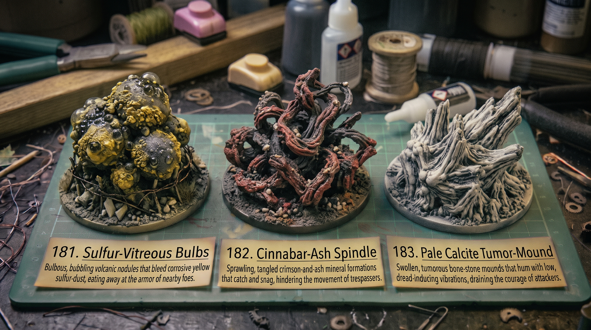
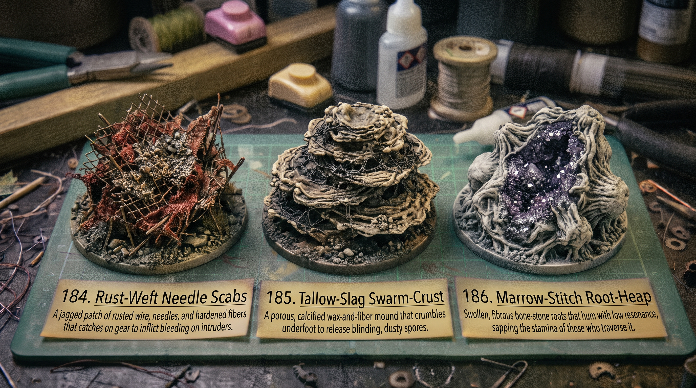

# Dark Craft specimens

Free-standing material and creature-mineral maquettes on named stands, photographed in threes. Nov 18 batch, unrated.

## specimens_01

Three specimen maquettes on stands: a blue-black crystal shard, a red calcified spiral, and a pale bristling spire.

Source (left in Downloads, not moved): `Gemini_Generated_Image_568fdl568fdl568f.jpg`

## specimens_02

Three specimen maquettes: a stacked rust-red ore stitch, a pale lace-shell, and a ridge of bone-white shards.

Source (left in Downloads, not moved): `Gemini_Generated_Image_5kq4od5kq4od5kq4.jpg`

## specimens_03

Three specimen maquettes: a sulfur-yellow bulb cluster, a rust-and-wire spindle, and a pale calcite mound.

Source (left in Downloads, not moved): `Gemini_Generated_Image_e82je4e82je4e82j.jpg`

## specimens_04

Three specimen maquettes: a rust needle scab, a yellow slag-seam crust, and a stitched marrow-rust heap.

Source (left in Downloads, not moved): `Gemini_Generated_Image_d3gpk9d3gpk9d3gp.jpg`

