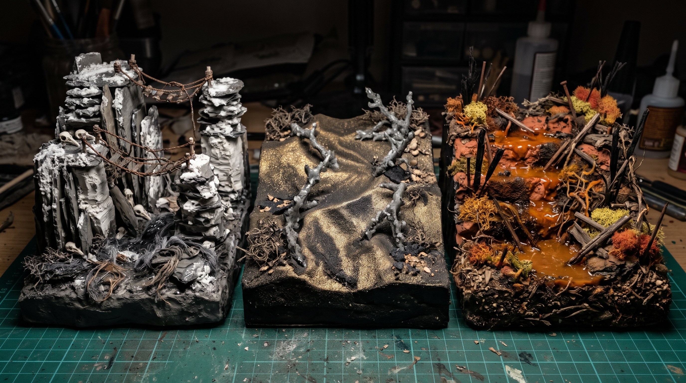
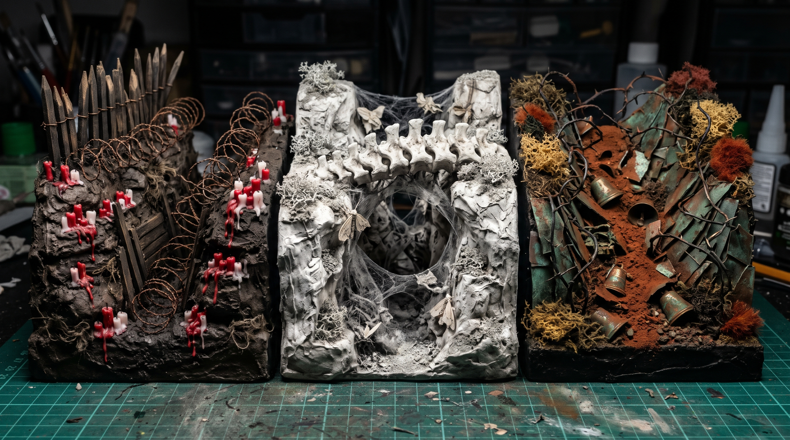
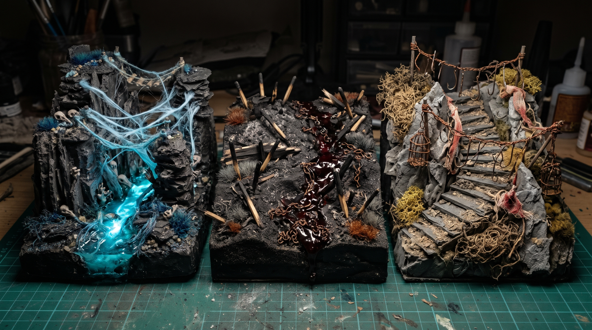
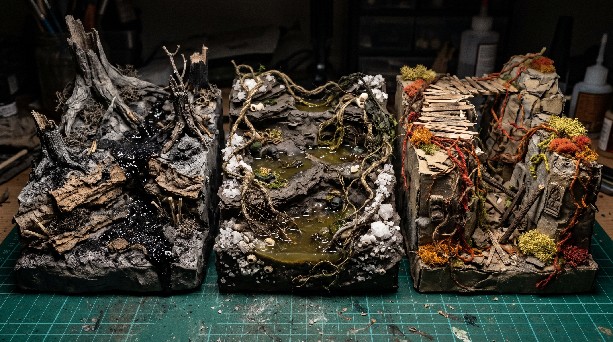
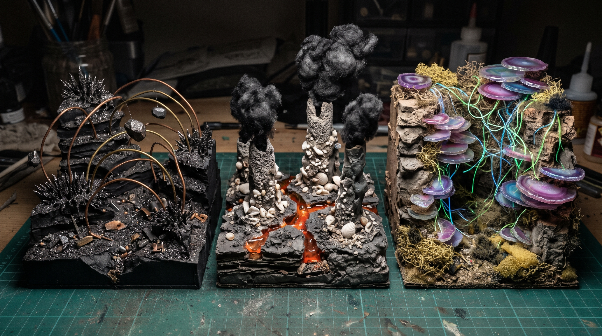
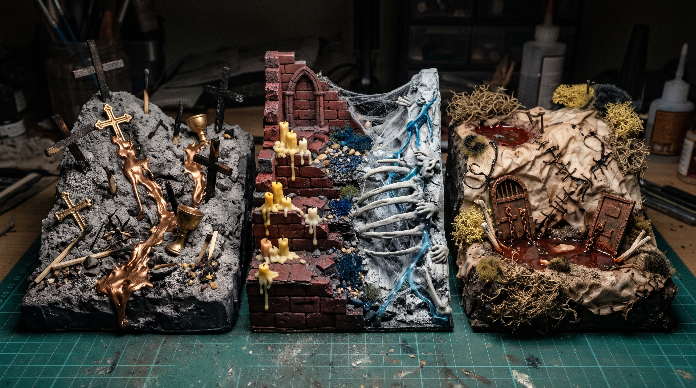

# Dark Craft terrain

Ground blocks and landforms. Craft-material diorama pieces on a green cutting mat, photographed as a set of three unless noted.

## terrain_01

Three terrain blocks: red clay canyon with brass wire, black lava with glassy pools and loofah discs, and bamboo with twine and moss.

## terrain_02

Ruined white towers with a rope bridge, a dark sand dune with fallen branches, and an orange sludge hillside studded with sticks and moss.

## terrain_03

Terraced turquoise pools in yellow stone, a scaffolded mine canyon with crystal carts, and a root-choked bone pit in mud.

## terrain_04

Muddy field with a stake palisade, barbed wire and candles; a bone-white cave mouth in webbing; and a rusted slope with moss and metal cups.

## terrain_05

Glowing blue cave waterfall, a spiked ash field with a blood rivulet, and a rope-bridge stair over a ravine.

## terrain_06

Burnt stumps along a black stream, a root-choked swamp pool, and cardboard cliffs linked by a stick bridge and moss.

## terrain_07

Black crystal spires with copper arcs, volcanic vents with lava and smoke, and a bank of glowing purple shelf mushrooms.

## terrain_08

An ice-shard field, a wood-and-amber resin waterfall, and terraced teal pools set with blue crystals and moss.

## terrain_09

A grave hill with crosses and a gold pour, ruined brick stairs with candles and ice-bound bones, and a desert hill with buried doors.
