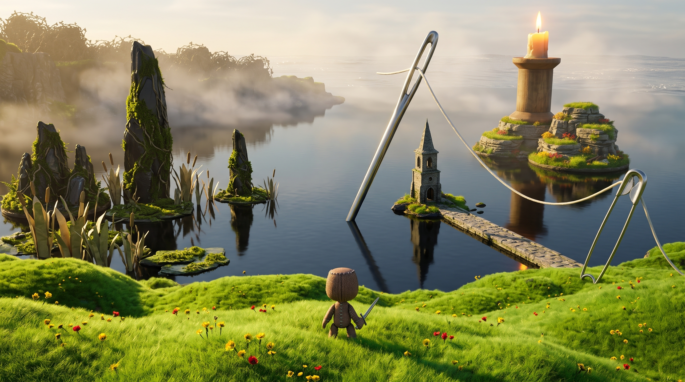
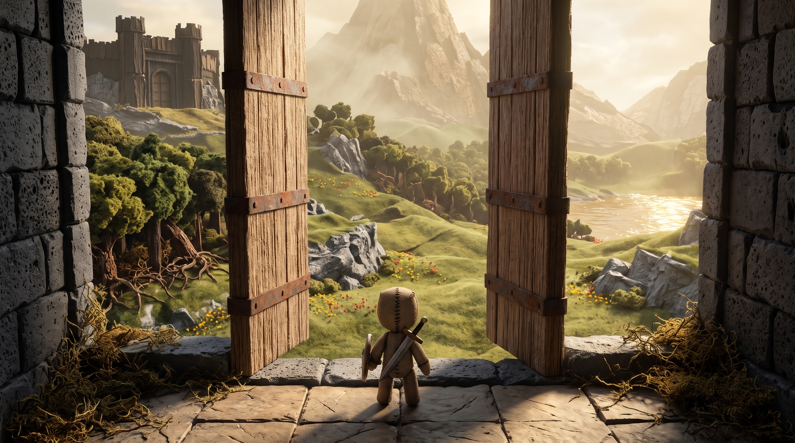
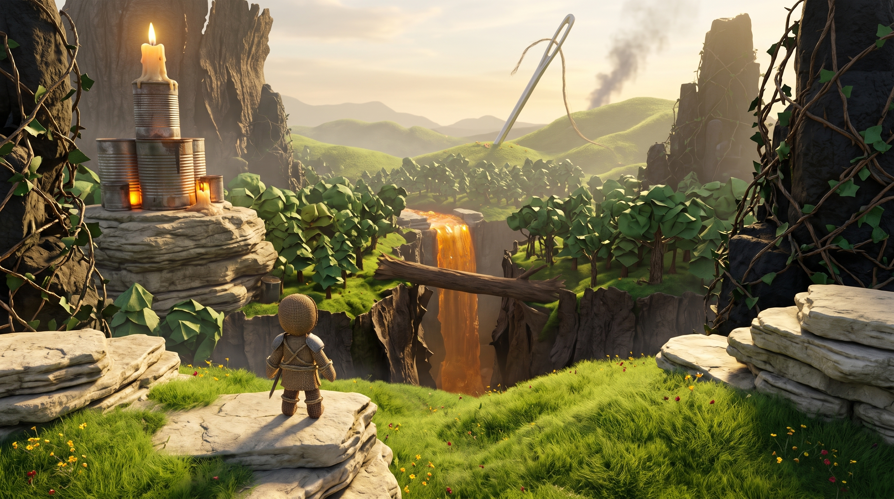
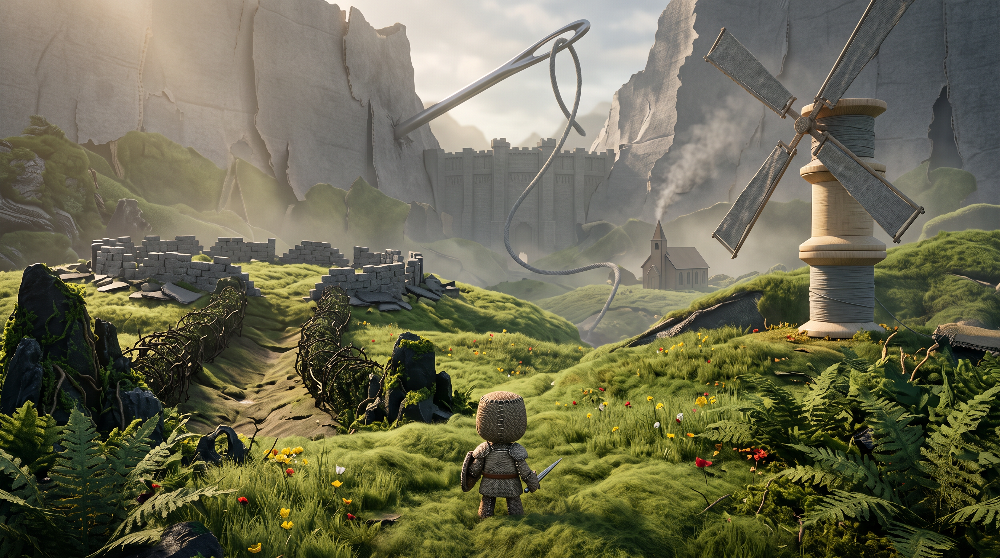
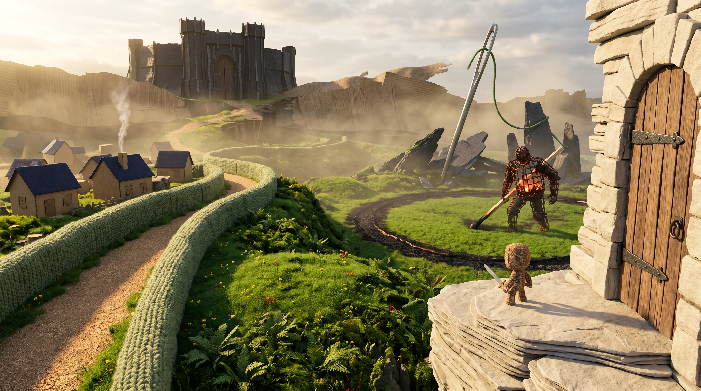
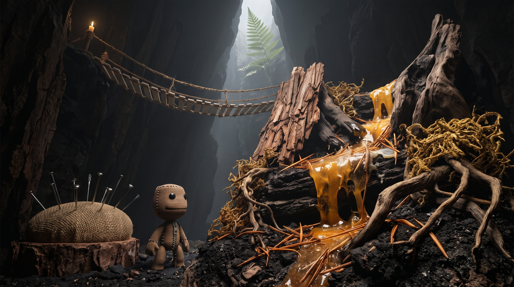

# Yarn-world landscapes

Cinematic yarn, felt, and Sackboy-style Higgsfield renders from Nov 18, 2026 (`archive (56).zip`). These are a different art style from the Dark Craft tabletop dioramas, so they live in their own folder instead of `dark-craft/`.

Original zip was left in Downloads. Images were copied, not moved.

## yarn_world_01

A felt lake island with a candle-tower lighthouse, a giant needle, and a small stitched figure.

Source: `hf_20261118_193922_eee9ea4b-f3b2-44c1-b2aa-3da6ab881dd4.png`

## yarn_world_02

A view out through a castle doorway onto a felt fortress, courtyard, and green valley.

Source: `hf_20261118_193923_18ce9a04-399f-455d-ba3c-59b5b9bb5018.png`

## yarn_world_03

A stone tower with a candle, a resin waterfall, and a giant hook in the hills.

Source: `hf_20261118_193923_4624b38f-e8ba-440d-a682-76f51d088e33.png`

## yarn_world_04

A mountain path past ruins and a wooden windmill, with a crane hook over the cliffs.

Source: `hf_20261118_193924_474e6669-fd39-48e8-8b4d-4ece211c239f.png`

## yarn_world_05

A felt castle and cottage village beside a stitched yarn road.

Source: `hf_20261118_193924_c3856692-6cec-4ad0-ad6e-f73bc51b8c17.png`

## yarn_world_06

A cave mine with amber resin, a rope bridge, and a giant pin in the workings.

Source: `hf_20261118_193927_8e681479-58bd-467b-9191-7ad4c1b302f6.png`
